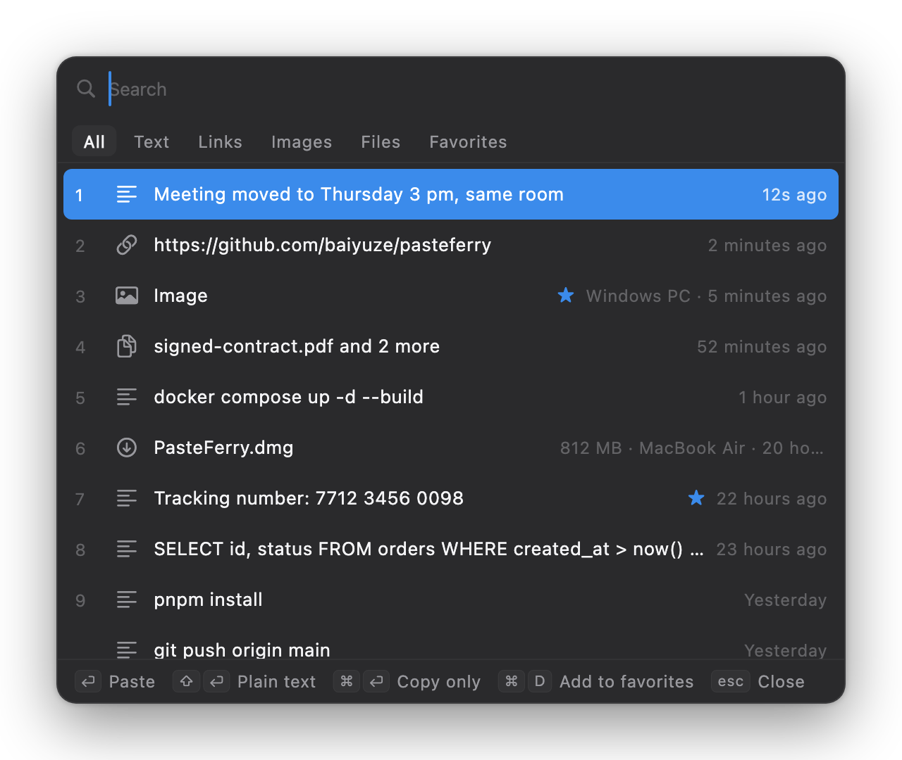
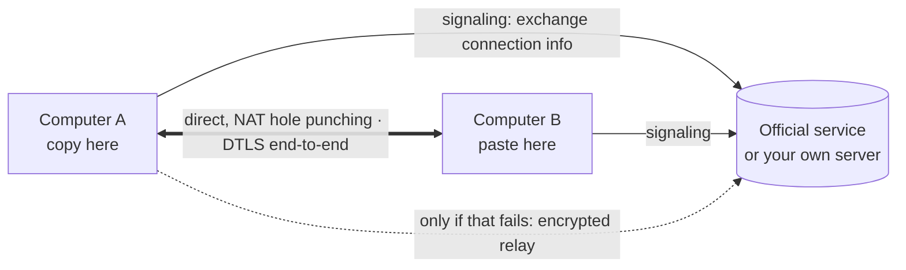
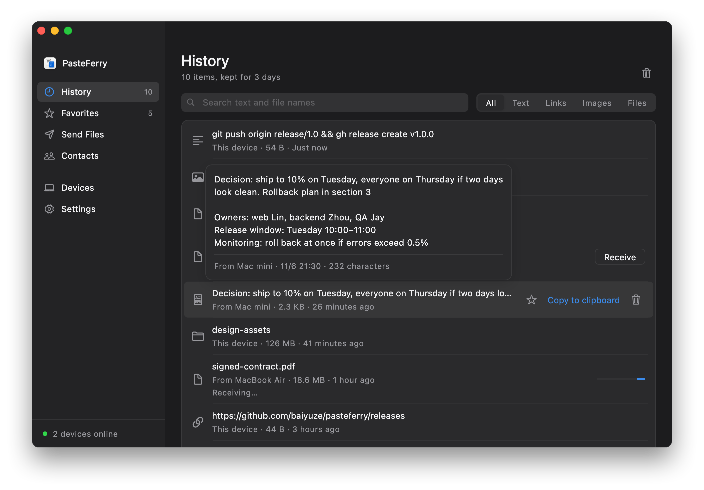
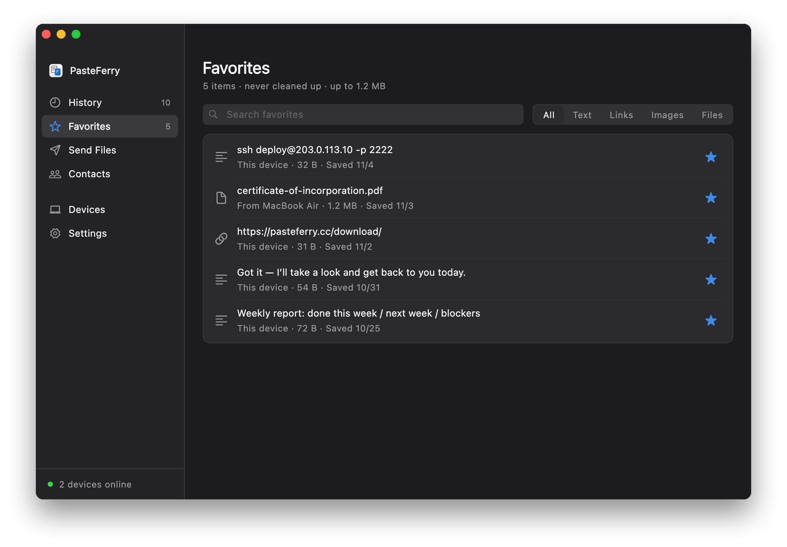
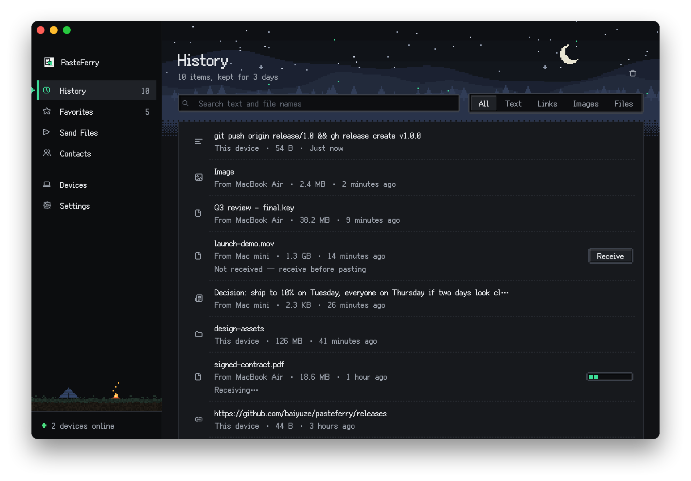
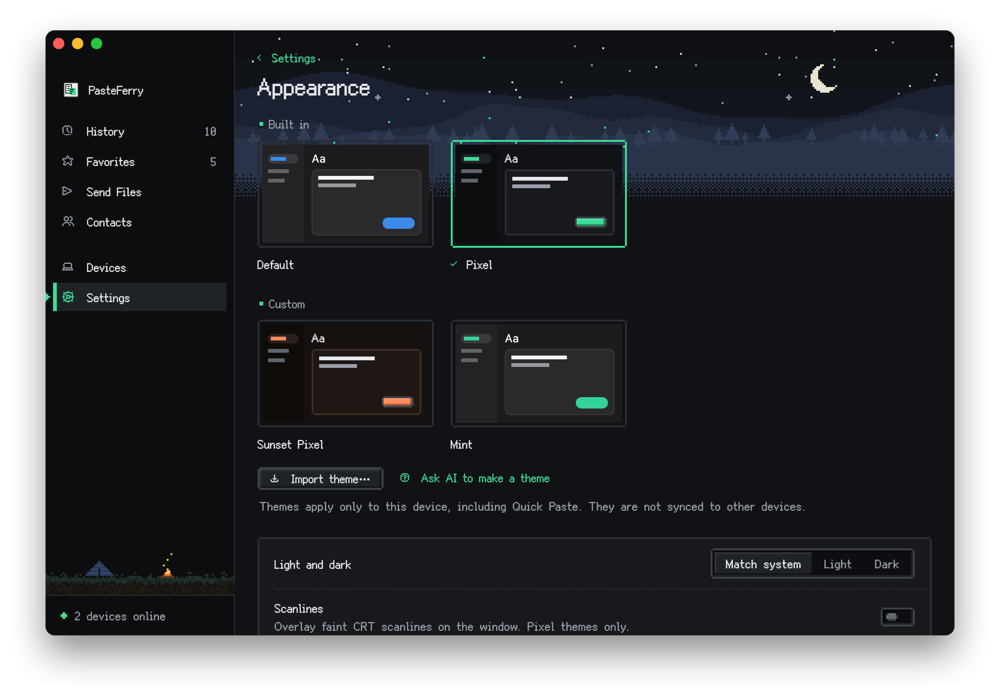

<p align="center">
  
</p>

<h1 align="center">PasteFerry</h1>

<p align="center">
  <strong>Copy on one computer, paste on another — even when they're on different networks.</strong><br>
  Clipboard sync, searchable history and file transfer that go directly between your devices, peer to peer.
  Home, office or phone hotspot: PasteFerry punches through NAT to connect them, and falls back to an
  end-to-end encrypted relay only when it can't. Mac, Windows and Linux, no shared account; Android and
  a phone web page send and receive files on your local network.
</p>

<p align="center">
  <a href="https://pasteferry.cc/en/download/"><strong>Download</strong></a>
  ·
  <a href="https://pasteferry.cc/en/">Website</a>
  ·
  <a href="https://pasteferry.cc/en/features/">Features</a>
  ·
  <a href="README.zh-CN.md">简体中文</a>
  ·
  <a href="https://gitee.com/baiyuze/pasteferry/releases">Gitee mirror</a>
</p>

<p align="center">
  
  
  
  
  
  
  
  
</p>

<p align="center">
  
</p>

<p align="center">If PasteFerry helps you, a ⭐ star helps more people find it.</p>

## Why

Universal Clipboard needs the same Apple ID and both Macs close by. AirDrop makes you accept every time, and also only works nearby. Messaging yourself means manual downloads and your files on someone else's server. With one Mac and one Windows PC, or one computer at home and one at the office, none of the built-in options work.

With PasteFerry you pair two computers once. After that, copy on one and paste on the other, whether they sit side by side or one is at the office and the other at home. The two connect to each other directly, so what you copy goes straight across instead of through someone's server. Everything you copied stays in your history: press <kbd>⌥V</kbd> (<kbd>Alt</kbd>+<kbd>V</kbd> on Windows and Linux) to find it and paste it into the app you're using.

| | PasteFerry | Universal Clipboard | AirDrop | Chat apps |
|---|:-:|:-:|:-:|:-:|
| Different Apple IDs | ✓ | — | Needs accepting | ✓ |
| Different networks (home ↔ office) | ✓ | — | — | ✓ |
| Direct device to device, even across networks | ✓ | Nearby only | Nearby only | Via their servers |
| Paste right away, nothing to accept | ✓ | ✓ | — | — |
| Between Mac and Windows | ✓ | — | — | ✓ |
| Files and whole folders | ✓ | Unreliable | ✓ | Zipped |
| History of what you copied | ✓ | — | — | Scroll back |
| Only your devices can decrypt content | ✓ | ✓ | ✓ | — |

## At its core: direct connections, across networks

Everything in PasteFerry rests on your computers talking to each other directly. What you copy and the files you send go from one to the other, not through anyone's server — whether the two share a Wi‑Fi network or sit behind different routers in different cities.



- **Same network: no server at all.** Computers find each other over mDNS and pair with a code.
- **Different networks: the server only introduces them.** The official service or your own server helps the two computers exchange connection details; then they punch through NAT and connect directly (WebRTC, built on [pion](https://github.com/pion/webrtc)).
- **Office networks with several uplinks.** Offices with two ISPs pick an uplink per destination. PasteFerry asks several STUN servers from one shared UDP port, learns its address on every uplink and sends them all to the peer, and decides which side sends first to get past routers that lock a port. A Mac on an office network with four uplinks connects directly to one on a home connection.
- **Mobile data and portable Wi‑Fi (2.13).** Many carrier NATs give every destination a new port, but hand the ports out in sequence. PasteFerry spots the pattern and predicts the next ports, so a laptop on a phone hotspot or a portable Wi‑Fi router can still connect directly. Only NATs that pick ports at random still need the relay.
- **IPv6 (2.13).** When both computers have public IPv6 addresses, they connect directly over IPv6, with no NAT to cross.
- **Fast across distances (2.12).** When a direct transfer between networks stays slow, PasteFerry opens parallel connections and keeps them only if they help.
- **Relay only as a fallback.** The relay forwards end-to-end encrypted packets it can't read and rides out network stalls of up to 35 seconds; the connection switches back to direct once punching succeeds while idle. **Devices** shows whether each computer is Direct or Relay.
- **Fingerprints checked at pairing.** Both screens show the same two lines, and every later message is signed, so the server can't impersonate your device.
- **Tested in a lab on every commit.** The [NAT traversal lab](tools/natlab) uses Linux network namespaces and iptables to model home routers, multi-uplink networks, port-randomizing NATs and more — 16 scenarios run against PasteFerry's real connection code. Port prediction is tested on pion's virtual network: a sequential symmetric NAT connects directly with it and fails without it.

Direct connections across networks are between the Mac, Windows and Linux apps. The Android app and the phone web page work on the local network for now.

Details: [how it works](https://pasteferry.cc/en/how/), and the design notes (Chinese) on [NAT traversal](design/nat-traversal.md) (multi-uplink networks, port prediction, IPv6) and [local network mode](design/lan-mode.md).

## Features

### Copy here, paste there

- **Text, rich text, images, files and whole folders.** What you copy is what comes out on the other side.
- **Size-aware transfer.** Anything under 50 MB (adjustable) is sent as you copy; larger files sync as a record you fetch when you need them.
- **Nothing lost while offline.** What you copy meanwhile lands in the other computer's history once it's back.

### Send Files (Android support in 2.8)

- Open **Send Files** and your paired computers appear on a radar. Drop files or whole folders onto one and they go straight to it.
- **Any size.** Progress, speed and time left are shown; if the connection drops, the transfer resumes where it stopped, and every file is checked with SHA-256.
- Received files go to Downloads (changeable) and stay out of your clipboard history. Desktop apps need 2.5 or later; Android needs 2.8 or later. Android works on the local network.

### Send to contacts (new in 2.6)

- Someone else's computer doesn't need pairing: add them as a **contact** with a one-time contact code, then drop files on their avatar, with a short note if you like.
- **They decide.** Every batch shows a request (who, which files, your note) and arrives only once accepted; trusted contacts can be set to accept automatically.
- **You decide who can send**: no one, contacts only (default), or everyone on the local network for 10 minutes.
- Contacts only exchange files and images. They never see your clipboard, history or other devices. On different networks, both sides turn on the service. Both computers need 2.6 or later.

### Share files from other apps (new in 2.12.2)

System menus use the system language; confirmation screens use the app language. All 18 interface languages are covered.

Select files, choose **PasteFerry**, review the batch and pick one paired receiving device. Sharing uses Send Files and does not add the files to clipboard sync.

- **Android 9+**: choose PasteFerry in the system share sheet. Files, photos and videos are supported; text and links are not included yet. Transfers use the local network.
- **Mac**: in Finder, right-click the files and choose **Services → Send with PasteFerry**. Enable the service in the system’s Services settings if hidden.
- **Windows**: use **Send with PasteFerry** in the classic right-click menu. On Windows 11, open **Show more options** first. The installer has an optional menu task; portable builds do not register it automatically.
- **Linux**: open **Settings → Send Files → Install menus** for Nautilus Scripts and Dolphin. The tarball’s `install.sh` also installs these entries; use **Remove menus** before uninstalling a manually installed entry.

### Quick paste

- Press <kbd>⌥V</kbd> (<kbd>Alt</kbd>+<kbd>V</kbd> on Windows and Linux) in any app and your history appears in the middle of the screen.
- Type to search — Chinese text matches by pinyin, too.
- Press <kbd>1</kbd>–<kbd>9</kbd> or Return and the item is pasted where your cursor was; <kbd>⇧</kbd><kbd>↩</kbd> pastes plain text, <kbd>⌘</kbd><kbd>↩</kbd> only copies. Change or turn off the shortcut in Settings.

### History and favorites

- **History** of the last 3 days (adjustable) from all your computers, filtered by text, links, images or files. Rest the pointer on an item to see the full text, a larger image or every file name.
- **Favorites**: star what you reuse to keep a copy. Favorites never expire and survive clearing your history.

<table>
  <tr>
    <td></td>
    <td></td>
  </tr>
</table>

### Themes (new in 2.10)

- **Settings → Appearance** lists the built-in themes (Default and Pixel) and your custom ones, with light, dark or match-the-system.
- **Pixel** uses a bitmap font, notched blocks and bevelled buttons on a neutral graphite or paper palette with a pixel-green accent. A night or daytime scene sits in the header, a campfire or small house at the bottom of the sidebar, empty pages get pixel illustrations, and Send Files flies a paper plane and bursts into stars when it's done. CRT scanlines are optional.
- **Custom themes**: duplicate a built-in theme, import or export `.pasteferry-theme.json` files, delete the ones you don't need. Saving checks text contrast and warns when something would be hard to read.
- **Ask an AI to make one**: `pasteferry-cli mcp` lets Claude, Cursor and other MCP apps design, check and apply a theme (see [below](#make-a-theme-with-ai-mcp)).
- A theme applies only to the device you set it on (on a computer, the main window and quick paste) and isn't synced. The Android app picks its own theme in its Settings → Appearance.

<table>
  <tr>
    <td></td>
    <td></td>
  </tr>
</table>

### And

- Runs in the background, starts at login, recovers from crashes; checks for updates and installs them after you confirm.
- 18 interface languages: English, Simplified Chinese, Traditional Chinese (Taiwan and Hong Kong), Japanese, Korean, Arabic (right to left), German, French, Spanish, Portuguese (Brazil), Italian, Russian, Ukrainian, Polish, Turkish, Vietnamese and Indonesian.

## Get started

New here? The **[quick start](https://pasteferry.cc/en/start/)** walks through it with screenshots.

**1. Install the app** on each computer from the **[download page](https://pasteferry.cc/en/download/)**:

- **Mac** (macOS 13+): [Apple silicon](https://github.com/baiyuze/pasteferry/releases/latest/download/PasteFerry-mac-apple-silicon.dmg) or [Intel](https://github.com/baiyuze/pasteferry/releases/latest/download/PasteFerry-mac-intel.dmg); a [universal](https://github.com/baiyuze/pasteferry/releases/latest/download/PasteFerry.dmg) build runs on both.
- **Windows** 10/11: [installer](https://github.com/baiyuze/pasteferry/releases/latest/download/PasteFerry-Setup.exe) or [portable zip](https://github.com/baiyuze/pasteferry/releases/latest/download/PasteFerry-windows-x64.zip).
- **Android** 9 or later, arm64: **[APK](https://github.com/baiyuze/pasteferry/releases/latest/download/PasteFerry-android-arm64.apk)** (beta; Android asks before installing it). Turn on **Devices → Phone web transfer** on the computer, then scan the code with your phone, or install the APK and pair it like another computer.
- **Any phone or tablet, nothing to install**: turn on **Devices → Phone web transfer** on the computer and scan the code shown there. The page in the phone's browser lists the records from the computer, copies a text to the phone, and sends text, photos and files back. It works on the same local network and the contents are encrypted.
- **iPhone and iPad**: there is no app yet, because distributing one needs an Apple developer certificate. Use the web page above instead; it does the same things in Safari.
- **Linux** (X11, or Wayland with XWayland): `.deb` for Ubuntu and Debian ([x64](https://github.com/baiyuze/pasteferry/releases/latest/download/PasteFerry-linux-amd64.deb), [ARM64](https://github.com/baiyuze/pasteferry/releases/latest/download/PasteFerry-linux-arm64.deb)), or `tar.gz` for other distributions ([x64](https://github.com/baiyuze/pasteferry/releases/latest/download/PasteFerry-linux-amd64.tar.gz), [ARM64](https://github.com/baiyuze/pasteferry/releases/latest/download/PasteFerry-linux-arm64.tar.gz)) — extract it and run `./PasteFerry/install.sh` to add it to the app menu.

The Mac app isn't notarized by Apple and the Windows app isn't code-signed yet: on Mac, allow it once under **System Settings → Privacy & Security → Open Anyway**; on Windows, click **More info → Run anyway**. Then click **Turn on background sync**, and allow PasteFerry when Windows Firewall asks, or when macOS asks to find devices on your local network. To let quick paste paste for you on a Mac, press <kbd>⌥V</kbd>, click **Allow…** and turn PasteFerry on under Accessibility.

**2. Pair.** On one computer, **Devices → Add device → Show a code**; on the other, **Enter a code**. Confirm only if both screens show the same two fingerprint lines. From then on, copy on either one and paste on the other.

**3. Across networks (optional)**, pick how the computers find each other. Whichever you pick, content goes directly between them whenever a direct path exists:

| Way | Best for | You need |
|---|---|---|
| **[Official service](https://pasteferry.cc/en/official/)** | Different networks, no server of your own | Turn on **Use the service** in Settings → Connection on each computer (off by default). Relay, used only when a direct connection fails, currently allows 100 MB a day; direct traffic doesn't count |
| **[Same network](https://pasteferry.cc/en/lan/)** | Computers behind one router | Nothing |
| **[Public server](https://pasteferry.cc/en/cloud/)** | Full control | A Linux VM with a public IP; the smallest is enough |
| **[Tailscale](https://pasteferry.cc/en/tailscale/)** | Across networks without a server | [Tailscale](https://tailscale.com) on every computer; enter the other's Tailscale address when pairing |

Self-hosting takes one install command; see the [server deployment guide](server/deploy/README.md) (Linux, macOS, Windows, Docker).

| | Requirement |
|---|---|
| **Mac app** | macOS 13 Ventura or later; Apple silicon and Intel |
| **Windows app** | Windows 10 and 11, x64 |
| **Linux app** | x64 or ARM64; an X11 desktop, or Wayland with XWayland (GNOME and KDE have it by default); GTK 3 |
| **Server** | Optional: Linux (x86_64, ARM64; systemd or Docker), macOS, or Windows 10/11 x64 |
| **Android app** | 9 or later, arm64; beta, so Android asks before installing it |
| **Phone web page** | Any phone or tablet on the same network; nothing to install |
| **iPhone / iPad** | No app: distributing one needs an Apple developer certificate, and iOS doesn't let apps watch the clipboard in the background. Use the web page instead |

### Install the Mac app with Homebrew

The official tap installs the desktop app and links its bundled CLI into your command path:

```sh
brew tap baiyuze/tap
brew install --cask baiyuze/tap/pasteferry
```

If PasteFerry was installed manually, quit it and move the existing `/Applications/PasteFerry.app`
out of the way first. Keep application data to preserve pairings, history and settings.
Open the installed app, enable background sync and grant the requested permissions.
To update through Homebrew, including this app's built-in updater support:

```sh
brew update
brew upgrade --cask --greedy baiyuze/tap/pasteferry
```

Uninstall with `brew uninstall --cask baiyuze/tap/pasteferry`; user data is preserved.
See the [official tap](https://github.com/baiyuze/homebrew-tap).

### Command-line queries (2.9 and later)

Desktop packages include `pasteferry-cli`. Homebrew links it into your command path.
For a manually installed Mac app, use `/Applications/PasteFerry.app/Contents/Helpers/pasteferry-cli`;
on Windows, use `pasteferry-cli.exe` from the installation folder; on Linux, use `pasteferry-cli`.

```sh
pasteferry-cli version
pasteferry-cli -json status
pasteferry-cli -json devices
pasteferry-cli -json history
pasteferry-cli -json config get
```

`version` works without the background service. Other queries read the current user's running service.
Put `-json` before the command to receive an `ok`/`data` or `ok`/`error` JSON response.
History returns the latest 20 record summaries. Without `-json`, output remains human-readable.
Use `-data-dir DIR` to select an existing running instance; the CLI does not start a service.
See the [CLI JSON reference](design/cli-json.md) for the supported read-only queries and output format.

### Make a theme with AI (MCP)

`pasteferry-cli mcp` is an MCP server (2.10 and later). Add it to an AI app, then ask for a theme — for example "make me a cyberpunk theme". The AI reads the theme format, picks colors, checks contrast, saves the theme and applies it. It can only read and write themes and background images; it never sees your history, devices or contacts. Settings → Appearance → **Ask AI to make a theme** shows the configuration with this computer's path filled in.

Claude Desktop and Cursor (`~/.cursor/mcp.json`):

```json
{
  "mcpServers": {
    "pasteferry": {
      "command": "/Applications/PasteFerry.app/Contents/Helpers/pasteferry-cli",
      "args": ["mcp"]
    }
  }
}
```

Claude Code:

```sh
claude mcp add pasteferry -- /Applications/PasteFerry.app/Contents/Helpers/pasteferry-cli mcp
```

On Windows the command is `%LOCALAPPDATA%\Programs\PasteFerry\pasteferry-cli.exe`; with the Linux `.deb` it's `/usr/bin/pasteferry-cli`. The background service must be running. See [Make a theme with AI](guide/ai-themes.md) for the tools and more examples.

## Documentation

- [How it works](guide/how-it-works.md): architecture, NAT traversal, security model, fallbacks, lessons learned
- [Troubleshooting](guide/troubleshooting.md) and known limitations
- [Make a theme with AI](guide/ai-themes.md) (MCP)
- Guides with screenshots: [quick start](https://pasteferry.cc/en/start/) · [official service](https://pasteferry.cc/en/official/) · [same network](https://pasteferry.cc/en/lan/) · [public server](https://pasteferry.cc/en/cloud/) · [Tailscale](https://pasteferry.cc/en/tailscale/)
- [Server deployment](server/deploy/README.md), [building from source](guide/building.md)
- Design notes (Chinese): [NAT traversal on multi-uplink networks](design/nat-traversal.md), [local network mode](design/lan-mode.md), [quick paste and favorites](design/quick-paste-and-favorites.md), [Send Files](design/send-files.md), [Windows client](design/windows-client.md), [themes](design/themes.md), [pixel theme](design/pixel-theme.md), [MCP](design/mcp.md)
- [Privacy](PRIVACY.md), [security](SECURITY.md), [official service protocol](design/official-gateway.md)
- [Changelog](CHANGELOG.md)

## Contributing

Please read the [contribution guidelines](CONTRIBUTING.md) before opening a pull request.
Keep each PR focused on one independent goal, including its related tests and documentation.
Discuss larger changes in an issue first and describe the checks you actually ran in the PR template.

## Support the project

PasteFerry is free and open source. If it helps you, **a ⭐ star** is the best support and helps others who need it find it. Questions and ideas are welcome as [issues](https://github.com/baiyuze/pasteferry/issues).

## License

PasteFerry is free and open source under the [GNU AGPL-3.0](LICENSE): anyone, companies included, can use and modify it, but distributing it or offering a modified version over a network means publishing your source under the same license. See [LICENSING.md](LICENSING.md) for details. Versions 1.2.0 and earlier remain under the MIT License.
