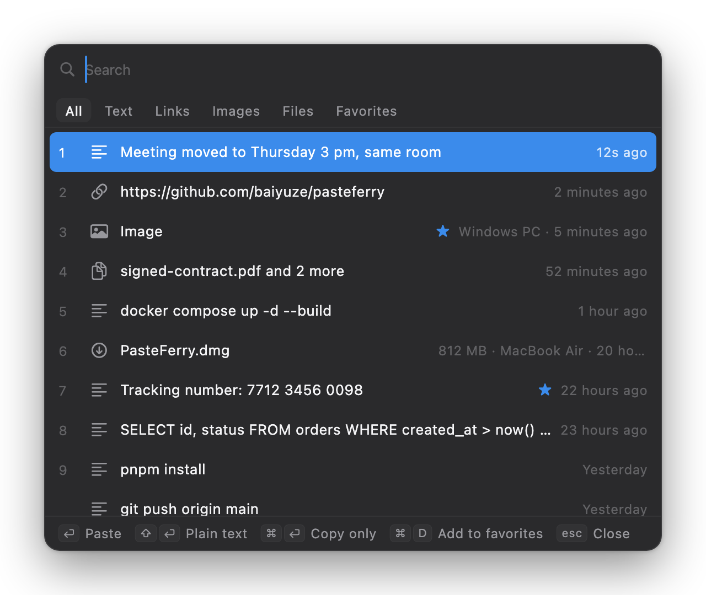
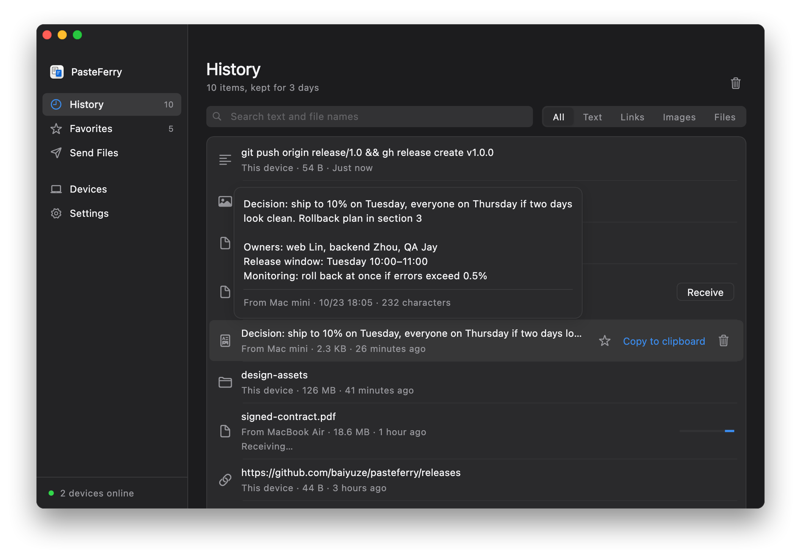
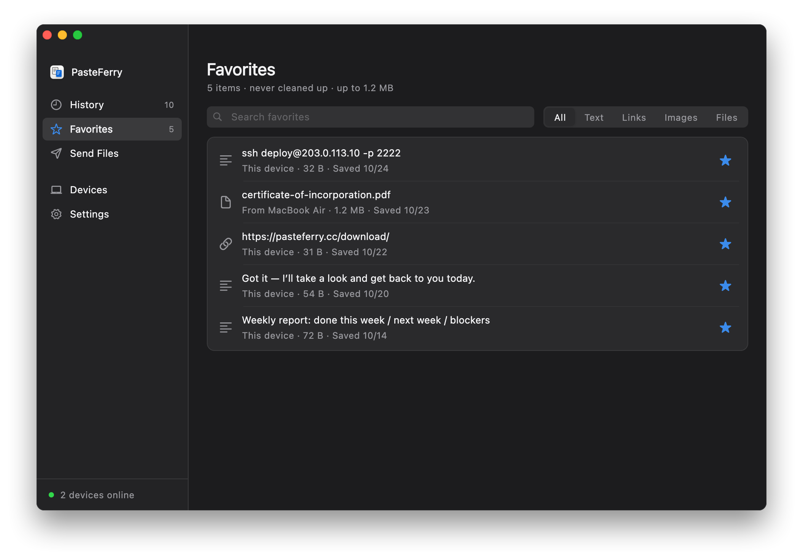
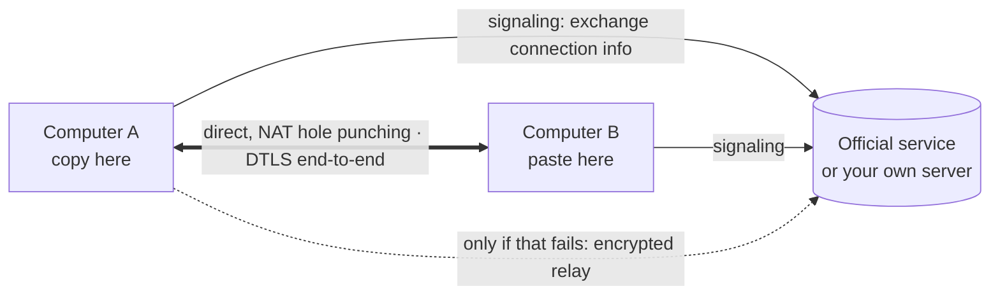

  

<h1 align="center">PasteFerry</h1>

  Copy on one computer, paste on the other — and press <kbd>⌥V</kbd> to bring back anything you copied. 
  Mac, Windows and Linux, across accounts, connected directly even across networks.

  <a href="https://pasteferry.cc/en/download/"><strong>Download</strong></a>
  ·
  <a href="https://pasteferry.cc/en/">Website</a>
  ·
  <a href="https://pasteferry.cc/en/features/">Features</a>
  ·
  <a href="README.zh-CN.md">简体中文</a>
  ·
  <a href="https://gitee.com/baiyuze/pasteferry/releases">Gitee mirror</a>

  
  
  
  
  

  

If PasteFerry helps you, a ⭐ star helps more people find it.

## Why

Universal Clipboard needs the same Apple ID and both Macs close by. AirDrop makes you accept every time. Messaging yourself means manual downloads and your files on someone else's server. With one Mac and one Windows PC, none of the built-in options work.

With PasteFerry you pair two computers once. After that, copy on one and paste on the other. Everything you copied stays in your history: press <kbd>⌥V</kbd> (<kbd>Alt</kbd>+<kbd>V</kbd> on Windows and Linux) to find it and paste it into the app you're using.

| | PasteFerry | Universal Clipboard | AirDrop | Chat apps |
|---|:-:|:-:|:-:|:-:|
| Different Apple IDs | ✓ | — | Needs accepting | ✓ |
| Different networks (home ↔ office) | ✓ | — | — | ✓ |
| Paste right away, nothing to accept | ✓ | ✓ | — | — |
| Between Mac and Windows | ✓ | — | — | ✓ |
| Files and whole folders | ✓ | Unreliable | ✓ | Zipped |
| History of what you copied | ✓ | — | — | Scroll back |
| Only your devices can decrypt content | ✓ | ✓ | ✓ | — |

## Features

### Copy here, paste there

- **Text, rich text, images, files and whole folders.** What you copy is what comes out on the other side.
- **Size-aware transfer.** Anything under 50 MB (adjustable) is sent as you copy; larger files sync as a record you fetch when you need them.
- **Nothing lost while offline.** What you copy meanwhile lands in the other computer's history once it's back.

### Quick paste (new in 2.4)

- Press <kbd>⌥V</kbd> (<kbd>Alt</kbd>+<kbd>V</kbd> on Windows and Linux) in any app and your history appears in the middle of the screen.
- Type to search — Chinese text matches by pinyin, too.
- Press <kbd>1</kbd>–<kbd>9</kbd> or Return and the item is pasted where your cursor was; <kbd>⇧</kbd><kbd>↩</kbd> pastes plain text, <kbd>⌘</kbd><kbd>↩</kbd> only copies. Change or turn off the shortcut in Settings.

### History and favorites

- **History** of the last 3 days (adjustable) from all your computers, filtered by text, links, images or files. Rest the pointer on an item to see the full text, a larger image or every file name.
- **Favorites**: star what you reuse to keep a copy. Favorites never expire and survive clearing your history.

<table>
  <tr>
    <td></td>
    <td></td>
  </tr>
</table>

### And

- Runs in the background, starts at login, recovers from crashes; checks for updates and installs them after you confirm.
- English, Simplified Chinese, Traditional Chinese (Taiwan and Hong Kong) and Japanese.

## At its core: direct connections

Everything in PasteFerry rests on two computers talking to each other directly: what you copy goes from one to the other, not through anyone's server.

- **No server on the same network.** Computers find each other over mDNS and pair with a code.
- **Across networks the server only introduces them.** The official service or your own server helps the two computers exchange connection details; then they punch through NAT and connect directly (WebRTC, built on [pion](https://github.com/pion/webrtc)).
- **Direct even on multi-uplink networks.** Offices with two ISPs pick an uplink per destination. PasteFerry asks several STUN servers from one shared UDP port, learns its address on every uplink and sends them all to the peer, and decides which side sends first to get past routers that lock a port. A Mac on an office network with four uplinks connects directly to one on a home connection.
- **Relay only as a fallback.** The relay forwards end-to-end encrypted packets it can't read, and the connection switches back to direct once punching succeeds while idle.
- **Fingerprints checked at pairing.** Both screens show the same two lines, and every later message is signed, so the server can't impersonate your device.
- **Tested in a lab on every commit.** The [NAT traversal lab](tools/natlab) uses Linux network namespaces and iptables to model home routers, multi-uplink networks, port-randomizing NATs and more — 16 scenarios run against PasteFerry's real connection code.

Details: [how it works](https://pasteferry.cc/en/how/), and the design notes (Chinese) on [NAT traversal on multi-uplink networks](design/nat-traversal.md) and [local network mode](design/lan-mode.md).

## Get started

New here? The **[quick start](https://pasteferry.cc/en/start/)** walks through it with screenshots.

**1. Install the app** on each computer from the **[download page](https://pasteferry.cc/en/download/)**:

- **Mac** (macOS 13+): [Apple silicon](https://github.com/baiyuze/pasteferry/releases/latest/download/PasteFerry-mac-apple-silicon.dmg) or [Intel](https://github.com/baiyuze/pasteferry/releases/latest/download/PasteFerry-mac-intel.dmg); a [universal](https://github.com/baiyuze/pasteferry/releases/latest/download/PasteFerry.dmg) build runs on both.
- **Windows** 10/11: [installer](https://github.com/baiyuze/pasteferry/releases/latest/download/PasteFerry-Setup.exe) or [portable zip](https://github.com/baiyuze/pasteferry/releases/latest/download/PasteFerry-windows-x64.zip).
- **Linux** (X11, or Wayland with XWayland): `.deb` for Ubuntu and Debian ([x64](https://github.com/baiyuze/pasteferry/releases/latest/download/PasteFerry-linux-amd64.deb), [ARM64](https://github.com/baiyuze/pasteferry/releases/latest/download/PasteFerry-linux-arm64.deb)), or `tar.gz` for other distributions ([x64](https://github.com/baiyuze/pasteferry/releases/latest/download/PasteFerry-linux-amd64.tar.gz), [ARM64](https://github.com/baiyuze/pasteferry/releases/latest/download/PasteFerry-linux-arm64.tar.gz)) — extract it and run `./PasteFerry/install.sh` to add it to the app menu.

The Mac app isn't notarized by Apple and the Windows app isn't code-signed yet: on Mac, allow it once under **System Settings → Privacy & Security → Open Anyway**; on Windows, click **More info → Run anyway**. Then click **Turn on background sync**, and allow PasteFerry when Windows Firewall asks, or when macOS asks to find devices on your local network. To let quick paste paste for you on a Mac, press <kbd>⌥V</kbd>, click **Allow…** and turn PasteFerry on under Accessibility.

**2. Pair.** On one computer, **Devices → Add device → Show a code**; on the other, **Enter a code**. Confirm only if both screens show the same two fingerprint lines. From then on, copy on either one and paste on the other.

**3. Across networks (optional)**, pick a way to connect:

| Way | Best for | You need |
|---|---|---|
| **[Official service](https://pasteferry.cc/en/official/)** | Different networks, no server of your own | Turn on **Use official service** in Settings on each computer (off by default). Relay, used only when a direct connection fails, currently allows 100 MB a day; direct traffic doesn't count |
| **[Same network](https://pasteferry.cc/en/lan/)** | Computers behind one router | Nothing |
| **[Public server](https://pasteferry.cc/en/cloud/)** | Full control | A Linux VM with a public IP; the smallest is enough |
| **[Tailscale](https://pasteferry.cc/en/tailscale/)** | Across networks without a server | [Tailscale](https://tailscale.com) on every computer; enter the other's Tailscale address when pairing |

Self-hosting takes one install command; see the [server deployment guide](server/deploy/README.md) (Linux, macOS, Windows, Docker).

| | Requirement |
|---|---|
| **Mac app** | macOS 13 Ventura or later; Apple silicon and Intel |
| **Windows app** | Windows 10 and 11, x64 |
| **Linux app** | x64 or ARM64; an X11 desktop, or Wayland with XWayland (GNOME and KDE have it by default); GTK 3 |
| **Server** | Optional: Linux (x86_64, ARM64; systemd or Docker), macOS, or Windows 10/11 x64 |
| **iPhone / iPad** | Not supported: iOS doesn't let apps watch the clipboard in the background |

## Documentation

- [How it works](guide/how-it-works.md): architecture, NAT traversal, security model, fallbacks, lessons learned
- [Troubleshooting](guide/troubleshooting.md) and known limitations
- Guides with screenshots: [quick start](https://pasteferry.cc/en/start/) · [official service](https://pasteferry.cc/en/official/) · [same network](https://pasteferry.cc/en/lan/) · [public server](https://pasteferry.cc/en/cloud/) · [Tailscale](https://pasteferry.cc/en/tailscale/)
- [Server deployment](server/deploy/README.md), [building from source](guide/building.md)
- Design notes (Chinese): [NAT traversal on multi-uplink networks](design/nat-traversal.md), [local network mode](design/lan-mode.md), [quick paste and favorites](design/quick-paste-and-favorites.md), [Windows client](design/windows-client.md)
- [Privacy](PRIVACY.md), [security](SECURITY.md), [official service protocol](design/official-gateway.md)
- [Changelog](CHANGELOG.md)

## Support the project

PasteFerry is free and open source. If it helps you, **a ⭐ star** is the best support and helps others who need it find it. Questions and ideas are welcome as [issues](https://github.com/baiyuze/pasteferry/issues).

## License

PasteFerry is free and open source under the [GNU AGPL-3.0](LICENSE): anyone, companies included, can use and modify it, but distributing it or offering a modified version over a network means publishing your source under the same license. See [LICENSING.md](LICENSING.md) for details. Versions 1.2.0 and earlier remain under the MIT License.
