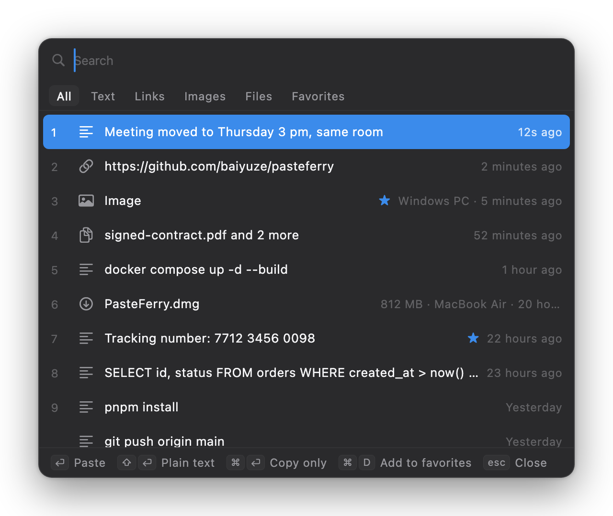
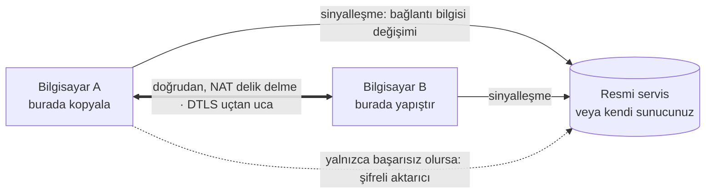
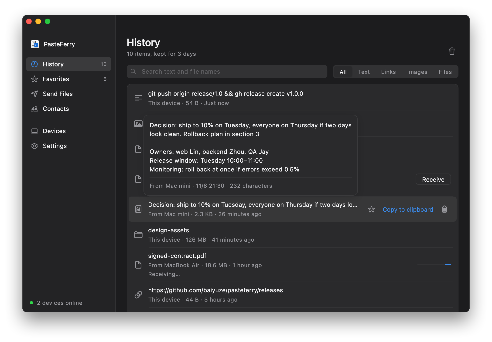
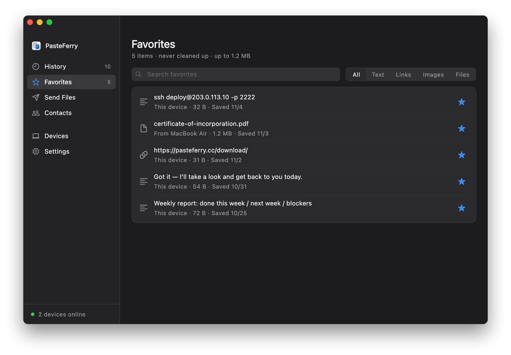
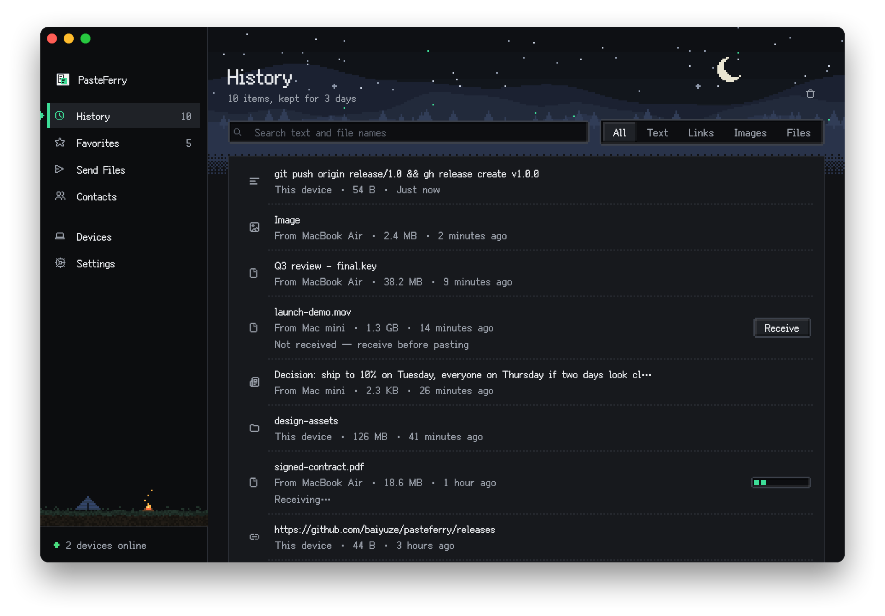
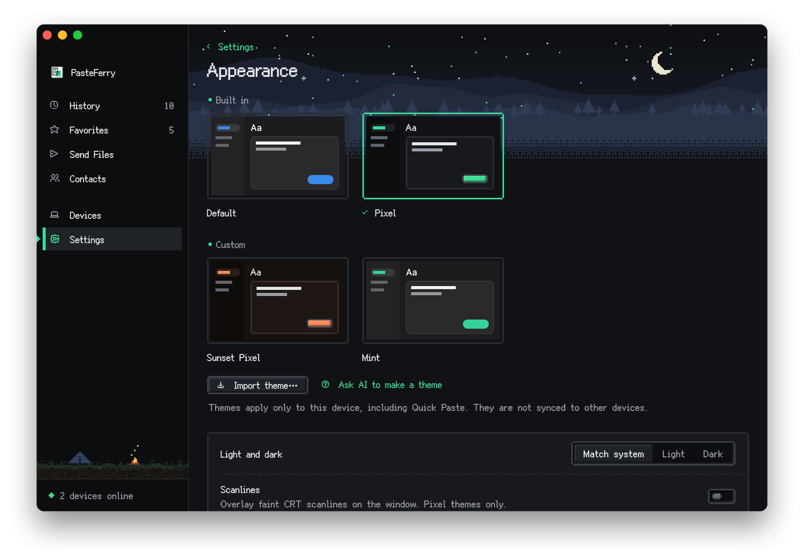

<p align="center">
  
</p>

<h1 align="center">PasteFerry</h1>

<p align="center">
  <strong>P2P pano eşitleme ve dosya aktarımı.</strong><br>
  Yerel ağınızda ve ağlar arasında doğrudan P2P; hiçbir şey buluttan geçmez. Uçtan uca şifreli;
  yalnızca delik delme (hole punching) başarısız olursa şifreli aktarıcı kullanılır. Mac, Windows ve
  Linux için ortak hesap gerektirmeyen pano eşitleme, aranabilir geçmiş ve dosya aktarımı; Android ve
  bir telefon web sayfası yerel ağınızda dosya gönderip alır.
</p>

<p align="center">
  <a href="https://pasteferry.cc/en/download/"><strong>İndir</strong></a>
  ·
  <a href="https://pasteferry.cc/en/">Web sitesi</a>
  ·
  <a href="https://pasteferry.cc/en/features/">Özellikler</a>
  ·
  <a href="README.md">English</a>
  ·
  <a href="README.zh-CN.md">简体中文</a>
  ·
  <a href="https://gitee.com/baiyuze/pasteferry/releases">Gitee yansısı</a>
</p>

<p align="center">
  
  
  
  
  
  
  
  
</p>

<p align="center">
  
</p>

<p align="center">PasteFerry işinize yararsa, ⭐ yıldız vermeniz daha fazla kişinin onu bulmasına yardımcı olur.</p>

## Neden

Evrensel Pano aynı Apple Kimliğini ve her iki Mac'in yakın olmasını gerektirir. AirDrop her seferinde onay ister ve yine yalnızca yakında çalışır. Kendinize mesaj atmak ise elle indirme ve dosyalarınızın başkasının sunucusunda durması anlamına gelir. Bir Mac ile bir Windows PC arasında ya da biri evde biri ofiste iki bilgisayar arasında yerleşik seçeneklerin hiçbiri çalışmaz.

PasteFerry ile iki bilgisayarı bir kez eşleştirirsiniz. Ondan sonra birinde kopyalayıp diğerinde yapıştırırsınız. Yerel ağda ve ağlar arasında P2P bağlanırlar; içerik asla başkasının sunucusundan geçmez. Kopyaladığınız her şey geçmişinizde kalır: bulmak ve kullandığınız uygulamaya yapıştırmak için <kbd>⌥V</kbd> (Windows ve Linux'ta <kbd>Alt</kbd>+<kbd>V</kbd>) tuşlarına basın.

| | PasteFerry | Universal Clipboard | AirDrop | Sohbet uygulamaları |
|---|:-:|:-:|:-:|:-:|
| Yerel ağda ve ağlar arasında doğrudan P2P | ✓ | Yalnızca yakında | Yalnızca yakında | Sunucuları üzerinden |
| Farklı Apple Kimlikleri | ✓ | — | Onay gerektirir | ✓ |
| Onay beklemeden hemen yapıştır | ✓ | ✓ | — | — |
| Mac ve Windows arasında | ✓ | — | — | ✓ |
| Dosyalar ve tüm klasörler | ✓ | Güvenilir değil | ✓ | Sıkıştırılmış |
| Kopyaladıklarınızın geçmişi | ✓ | — | — | Geri kaydır |
| İçeriği yalnızca cihazlarınız çözebilir | ✓ | ✓ | ✓ | — |

## Temelinde: yerel ağda ve ağlar arasında doğrudan bağlantılar

Cihazlar P2P bağlanır: yerel ağda sunucu olmadan doğrudan, ağlar arasında ise delik delme (hole punching) ile. İçerik başkasının sunucusundan değil, doğrudan bir cihazdan diğerine gider.



- **Aynı ağ: sunucu yok, tam yerel ağ hızı.** Cihazlar birbirini mDNS üzerinden bulur ve bir kodla eşleşir. Bilgisayarlar arasında Dosya Gönder, şifreli hızlı bir TCP bağlantısı kullanır: 1 GB'lık bir dosya bir Mac'ten bir Linux sanal makinesine 144 MB/sn hızla aktarıldı. Android uygulaması ve telefon web sayfası da yerel ağda doğrudan aktarım yapar.
- **Ağlar arasında delik delme.** Resmi servis veya kendi sunucunuz yalnızca sinyalleşmeyi yönetir ([pion](https://github.com/pion/webrtc) üzerine kurulu WebRTC).
- **Birden fazla çıkış hattına sahip ağlar.** İki İSS'li ağlar hedefe göre bir çıkış hattı seçer. PasteFerry tek bir paylaşılan UDP portundan birden fazla STUN sunucusuna sorar, her çıkış hattındaki adresini öğrenip tümünü eşe gönderir ve portu kilitleyen yönlendiricileri aşmak için hangi tarafın önce göndereceğine karar verir. Dört çıkış hattına sahip bir ağdaki Mac, ev bağlantısındaki bir bilgisayara doğrudan bağlanır.
- **Mobil veri ve taşınabilir Wi‑Fi (2.13).** Birçok operatör NAT'ı her hedefe yeni bir port verir ancak portları sırayla dağıtır. PasteFerry bu örüntüyü yakalar ve sonraki portları tahmin eder; böylece telefon erişim noktasındaki veya taşınabilir Wi‑Fi yönlendiricisindeki bir dizüstü bilgisayar doğrudan bağlanır. Yalnızca portları rastgele seçen NAT'lar hâlâ aktarıcıya ihtiyaç duyar.
- **IPv6 (2.13).** Her iki bilgisayarın da genel IPv6 adresi olduğunda, aşılacak bir NAT olmadan IPv6 üzerinden doğrudan bağlanırlar.
- **Yönlendirici port yönlendirme (2.14).** Yönlendirici UPnP, NAT-PMP veya PCP desteklediğinde ve genel bir adrese sahip olduğunda PasteFerry üzerinde bir port açar; böylece diğer cihaz ona doğrudan ulaşır.
- **Uzak mesafelerde hızlı (2.12).** Ağlar arasında doğrudan aktarım yavaş kaldığında PasteFerry paralel bağlantılar açar ve yalnızca işe yararlarsa bunları tutar.
- **Aktarıcı yalnızca yedek olarak.** Aktarıcı okuyamadığı uçtan uca şifreli paketleri iletir ve 35 saniyeye kadar ağ kesintilerini atlatır; boşta iken delik delme başarılı olduğunda bağlantı tekrar doğrudan moda geçer. **Devices** her bilgisayarın Direct (Doğrudan) mı yoksa Relay (Aktarıcı) mı olduğunu gösterir.
- **Eşleştirmede parmak izi doğrulaması.** Her iki ekran da aynı iki satırı gösterir ve sonraki her ileti imzalanır; böylece sunucu cihazınızı taklit edemez.
- **Her commit'te laboratuvarda test edilir.** [NAT traversal lab](tools/natlab), ev yönlendiricilerini, çoklu çıkış hatlı ağları, port rastgeleleştiren NAT'ları ve daha fazlasını modellemek için Linux ağ ad alanlarını ve iptables'ı kullanır — PasteFerry'nin gerçek bağlantı koduna karşı 21 senaryo çalıştırılır. Port tahmini pion'un sanal ağında test edilir: sıralı simetrik bir NAT onunla doğrudan bağlanır, onsuz başarısız olur.

Ağlar arasında doğrudan bağlantılar Mac, Windows ve Linux uygulamaları arasındadır. Android uygulaması ve telefon web sayfası şimdilik yerel ağda çalışır.

Ayrıntılar: [nasıl çalışır](https://pasteferry.cc/en/how/) ve [NAT geçişi](design/nat-traversal.md) (çoklu çıkış hatlı ağlar, port tahmini, IPv6) ile [yerel ağ modu](design/lan-mode.md) hakkındaki tasarım notları (Çince).

## Özellikler

### Burada kopyala, orada yapıştır

- **Metin, zengin metin, görseller, dosyalar ve tüm klasörler.** Kopyaladığınız şey karşı tarafta aynen çıkar.
- **Boyuta duyarlı aktarım.** 50 MB altındaki her şey (ayarlanabilir) kopyaladığınız anda gönderilir; daha büyük dosyalar ise ihtiyacınız olduğunda çekebileceğiniz bir kayıt olarak eşitlenir.
- **Çevrimdışıyken hiçbir şey kaybolmaz.** Bu sırada kopyaladıklarınız, diğer bilgisayar tekrar çevrimiçi olduğunda geçmişine düşer.

### Dosya Gönder (2.8 ile Android desteği)

- **Send Files** (Dosya Gönder) ekranını açın; eşleştirilmiş bilgisayarlarınız bir radarda görünür. Dosyaları veya tüm klasörleri birinin üzerine bırakın, doğrudan oraya giderler.
- **Her boyutta.** İlerleme, hız ve kalan süre gösterilir; bağlantı koparsa aktarım kaldığı yerden devam eder ve her dosya SHA-256 ile doğrulanır.
- Alınan dosyalar İndirilenler'e gider (değiştirilebilir) ve pano geçmişinizden ayrı tutulur. Masaüstü uygulamaları 2.5 veya üzeri, Android ise 2.8 veya üzeri sürüm gerektirir. Android yerel ağda çalışır.

### Kişilere gönder (2.6 ile yeni)

- Başkasının bilgisayarının eşleştirilmesi gerekmez: tek kullanımlık bir kişi koduyla onu **kişi** olarak ekleyin, ardından isterseniz kısa bir notla dosyaları avatarının üzerine bırakın.
- **Kararı onlar verir.** Her grup bir istek gösterir (kim, hangi dosyalar, notunuz) ve yalnızca kabul edildiğinde ulaşır; güvenilen kişiler otomatik kabul edecek şekilde ayarlanabilir.
- **Kimlerin gönderebileceğine siz karar verirsiniz**: hiç kimse, yalnızca kişiler (varsayılan) veya 10 dakika boyunca yerel ağdaki herkes.
- Kişiler yalnızca dosya ve görsel alışverişi yapar. Panonuzu, geçmişinizi veya diğer cihazlarınızı asla görmezler. Farklı ağlarda her iki taraf da servisi açar. Her iki bilgisayarın da 2.6 veya üzeri sürüme sahip olması gerekir.

### Diğer uygulamalardan dosya paylaş (2.12.2 ile yeni)

Sistem menüleri sistem dilini, onay ekranları ise uygulama dilini kullanır. 18 arayüz dilinin tümü kapsanır.

Dosyaları seçin, **PasteFerry**'yi seçin, grubu gözden geçirin ve eşleştirilmiş bir alıcı cihaz seçin. Paylaşım, Dosya Gönder özelliğini kullanır ve dosyaları pano eşitlemesine eklemez.

- **Android 9+**: sistem paylaşım sayfasında PasteFerry'yi seçin. Dosyalar, fotoğraflar ve videolar desteklenir; metin ve bağlantılar henüz dahil değildir. Aktarımlar yerel ağı kullanır.
- **Mac**: Finder'da dosyalara sağ tıklayın ve **Services → Send with PasteFerry** seçeneğini seçin. Gizliyse sistemin Servisler ayarlarından etkinleştirin.
- **Windows**: klasik sağ tık menüsünde **Send with PasteFerry** kullanın. Windows 11'de önce **Daha fazla seçenek göster**'i açın. Yükleyicide isteğe bağlı bir menü görevi vardır; taşınabilir derlemeler bunu otomatik olarak kaydetmez.
- **Linux**: Nautilus Scripts ve Dolphin için **Settings → Send Files → Install menus** yolunu açın. Tarball içindeki `install.sh` betiği de bu girdileri kurar; elle kurulmuş bir girdiyi kaldırmadan önce **Remove menus** kullanın.

### Hızlı yapıştırma

- Herhangi bir uygulamada <kbd>⌥V</kbd> (Windows ve Linux'ta <kbd>Alt</kbd>+<kbd>V</kbd>) tuşlarına basın; geçmişiniz ekranın ortasında belirir.
- Aramak için yazın — Çince metinler pinyin ile de eşleşir.
- <kbd>1</kbd>–<kbd>9</kbd> veya Return tuşuna basın, öğe imlecinizin bulunduğu yere yapıştırılır; <kbd>⇧</kbd><kbd>↩</kbd> düz metin yapıştırır, <kbd>⌘</kbd><kbd>↩</kbd> yalnızca kopyalar. Kısayolu Settings'ten değiştirebilir veya kapatabilirsiniz.

### Geçmiş ve favoriler

- Tüm bilgisayarlarınızdan son 3 günün (ayarlanabilir) **Geçmişi**; metin, bağlantı, görsel veya dosyalara göre filtrelenebilir. Tam metni, daha büyük bir görseli veya tüm dosya adlarını görmek için imleci bir öğenin üzerinde bekletin.
- **Favoriler**: bir kopyasını saklamak için sık kullandıklarınızı yıldızlayın. Favorilerin süresi asla dolmaz ve geçmişinizi temizleseniz bile silinmez.

<table>
  <tr>
    <td></td>
    <td></td>
  </tr>
</table>

### Temalar (2.10 ile yeni)

- **Settings → Appearance** yerleşik temaları (Default ve Pixel) ve özel temalarınızı açık, koyu veya sistemle eşleşen seçeneklerle listeler.
- **Pixel**, piksel yeşili vurgulu nötr grafit veya kağıt paleti üzerinde bitmap yazı tipi, çentikli bloklar ve eğimli düğmeler kullanır. Üst bilgi alanında gece veya gündüz manzarası, kenar çubuğunun altında bir kamp ateşi veya küçük bir ev yer alır; boş sayfalarda piksel çizimleri bulunur ve Dosya Gönder bir kağıt uçak uçurup bittiğinde yıldızlara dağılır. CRT tarama çizgileri isteğe bağlıdır.
- **Özel temalar**: yerleşik bir temayı çoğaltın, `.pasteferry-theme.json` dosyalarını içe veya dışa aktarın, ihtiyacınız olmayanları silin. Kaydederken metin kontrastı denetlenir ve okunması zor bir şey olduğunda uyarı verilir.
- **Bir yapay zekadan oluşturmasını isteyin**: `pasteferry-cli mcp`, Claude, Cursor ve diğer MCP uygulamalarının bir tema tasarlamasını, kontrol etmesini ve uygulamasını sağlar (bkz. [aşağıda](#yapay-zeka-ile-tema-oluşturma-mcp)).
- Tema yalnızca ayarladığınız cihaza uygulanır (bir bilgisayarda ana pencere ve hızlı yapıştırma) ve eşitlenmez. Android uygulaması kendi temasını kendi Settings → Appearance bölümünden seçer.

<table>
  <tr>
    <td></td>
    <td></td>
  </tr>
</table>

### Ve ayrıca

- Arka planda çalışır, oturum açılışında başlar, çökmelerden kurtulur; güncellemeleri denetler ve onayınızdan sonra kurar.
- 18 arayüz dili: İngilizce, Basitleştirilmiş Çince, Geleneksel Çince (Tayvan ve Hong Kong), Japonca, Korece, Arapça (sağdan sola), Almanca, Fransızca, İspanyolca, Portekizce (Brezilya), İtalyanca, Rusça, Ukraynaca, Lehçe, Türkçe, Vietnamca ve Endonezce.

## Başlangıç

Yeni misiniz? **[Hızlı başlangıç](https://pasteferry.cc/en/start/)** ekran görüntüleriyle adım adım anlatır.

**1. Uygulamayı kurun** — **[indirme sayfasından](https://pasteferry.cc/en/download/)** her bilgisayara kurun:

- **Mac** (macOS 13+): [Apple silicon](https://github.com/baiyuze/pasteferry/releases/latest/download/PasteFerry-mac-apple-silicon.dmg) veya [Intel](https://github.com/baiyuze/pasteferry/releases/latest/download/PasteFerry-mac-intel.dmg); [evrensel](https://github.com/baiyuze/pasteferry/releases/latest/download/PasteFerry.dmg) derleme her ikisinde de çalışır.
- **Windows** 10/11: [yükleyici](https://github.com/baiyuze/pasteferry/releases/latest/download/PasteFerry-Setup.exe) veya [taşınabilir zip](https://github.com/baiyuze/pasteferry/releases/latest/download/PasteFerry-windows-x64.zip).
- **Android** 9 veya üzeri, arm64: **[APK](https://github.com/baiyuze/pasteferry/releases/latest/download/PasteFerry-android-arm64.apk)** (beta; Android kurmadan önce sorar). Bilgisayarda **Devices → Phone web transfer** seçeneğini açın, ardından telefonunuzla kodu tarayın veya APK'yı kurup başka bir bilgisayar gibi eşleştirin.
- **Kurulum gerektirmeyen herhangi bir telefon veya tablet**: bilgisayarda **Devices → Phone web transfer** seçeneğini açın ve orada gösterilen kodu tarayın. Telefonun tarayıcısındaki sayfa bilgisayardaki kayıtları listeler, bir metni telefona kopyalar ve metin, fotoğraf ve dosyaları geri gönderir. Aynı yerel ağda çalışır ve içerikler şifrelenir.
- **iPhone ve iPad**: henüz bir uygulama yok çünkü dağıtmak için Apple geliştirici sertifikası gerekiyor. Bunun yerine yukarıdaki web sayfasını kullanın; Safari'de aynı işleri yapar.
- **Linux** (X11 veya XWayland ile Wayland): Ubuntu ve Debian için `.deb` ([x64](https://github.com/baiyuze/pasteferry/releases/latest/download/PasteFerry-linux-amd64.deb), [ARM64](https://github.com/baiyuze/pasteferry/releases/latest/download/PasteFerry-linux-arm64.deb)) veya diğer dağıtımlar için `tar.gz` ([x64](https://github.com/baiyuze/pasteferry/releases/latest/download/PasteFerry-linux-amd64.tar.gz), [ARM64](https://github.com/baiyuze/pasteferry/releases/latest/download/PasteFerry-linux-arm64.tar.gz)) — çıkartın ve uygulama menüsüne eklemek için `./PasteFerry/install.sh` komutunu çalıştırın.

Mac uygulaması Apple tarafından noter onaylı değildir ve Windows uygulaması henüz kod imzalı değildir: Mac'te **Sistem Ayarları → Gizlilik ve Güvenlik → Yine de Aç** altından bir kez izin verin; Windows'ta **Ek bilgi → Yine de çalıştır**'a tıklayın. Ardından **Turn on background sync** seçeneğine tıklayın ve Windows Güvenlik Duvarı sorduğunda ya da macOS yerel ağınızdaki cihazları bulmak için izin istediğinde PasteFerry'ye izin verin. Mac'te hızlı yapıştırmanın sizin yerinize yapıştırabilmesi için <kbd>⌥V</kbd> tuşlarına basın, **Allow…** düğmesine tıklayın ve Erişilebilirlik altında PasteFerry'yi açın.

**2. Eşleştirin.** Bir bilgisayarda **Devices → Add device → Show a code**; diğerinde **Enter a code**. Yalnızca her iki ekranda da aynı iki parmak izi satırı görünüyorsa onaylayın. O andan itibaren birinde kopyalayın, diğerinde yapıştırın.

**3. Ağlar arasında bağlanın.** Bilgisayarların birbirini nasıl bulacağını seçin; tek bir ağda bunu atlayabilirsiniz. Doğrudan bir yol olduğunda içerik aralarında doğrudan gider:

| Yöntem | En uygun kullanım | Gerekenler |
|---|---|---|
| **[Resmi servis](https://pasteferry.cc/en/official/)** | Farklı ağlar, kendi sunucunuz yok | Her bilgisayarda Settings → Connection içinde **Use the service** seçeneğini açın (varsayılan olarak kapalıdır). Yalnızca doğrudan bağlantı başarısız olduğunda kullanılan aktarıcı şu anda günde 100 MB izin verir; doğrudan trafik sayılmaz |
| **[Aynı ağ](https://pasteferry.cc/en/lan/)** | Tek bir yönlendirici arkasındaki bilgisayarlar | Hiçbir şey |
| **[Genel sunucu](https://pasteferry.cc/en/cloud/)** | Tam kontrol | Genel IP'ye sahip bir Linux sanal makinesi; en küçüğü yeterlidir |
| **[Tailscale](https://pasteferry.cc/en/tailscale/)** | Sunucu olmadan ağlar arasında | Her bilgisayarda [Tailscale](https://tailscale.com); eşleştirirken diğerinin Tailscale adresini girin |

Kendi sunucunuzda barındırma tek bir kurulum komutu alır; bkz. [sunucu dağıtım kılavuzu](server/deploy/README.md) (Linux, macOS, Windows, Docker).

| | Gereksinim |
|---|---|
| **Mac uygulaması** | macOS 13 Ventura veya üzeri; Apple silicon ve Intel |
| **Windows uygulaması** | Windows 10 ve 11, x64 |
| **Linux uygulaması** | x64 veya ARM64; bir X11 masaüstü veya XWayland ile Wayland (GNOME ve KDE'de varsayılan olarak vardır); GTK 3 |
| **Sunucu** | İsteğe bağlı: Linux (x86_64, ARM64; systemd veya Docker), macOS veya Windows 10/11 x64 |
| **Android uygulaması** | 9 veya üzeri, arm64; beta, bu nedenle Android kurmadan önce sorar |
| **Telefon web sayfası** | Aynı ağdaki herhangi bir telefon veya tablet; kurulum gerekmez |
| **iPhone / iPad** | Uygulama yok: dağıtmak için Apple geliştirici sertifikası gerekir ve iOS uygulamaların arka planda panoyu izlemesine izin vermez. Bunun yerine web sayfasını kullanın |

### Mac uygulamasını Homebrew ile kurma

Resmi tap, masaüstü uygulamasını kurar ve paket içindeki CLI'ı komut yolunuza bağlar:

```sh
brew tap baiyuze/tap
brew install --cask baiyuze/tap/pasteferry
```

PasteFerry elle kurulduysa önce uygulamadan çıkın ve mevcut `/Applications/PasteFerry.app` dosyasını kenara taşıyın. Eşleştirmeleri, geçmişi ve ayarları korumak için uygulama verilerini saklayın.
Kurulan uygulamayı açın, arka plan eşitlemesini etkinleştirin ve istenen izinleri verin.
Bu uygulamanın yerleşik güncelleyici desteği dahil Homebrew üzerinden güncellemek için:

```sh
brew update
brew upgrade --cask --greedy baiyuze/tap/pasteferry
```

`brew uninstall --cask baiyuze/tap/pasteferry` ile kaldırın; kullanıcı verileri korunur.
Bkz. [resmi tap](https://github.com/baiyuze/homebrew-tap).

### Komut satırı sorguları (2.9 ve üzeri)

Masaüstü paketleri `pasteferry-cli` içerir. Homebrew bunu komut yolunuza bağlar.
Elle kurulmuş bir Mac uygulaması için `/Applications/PasteFerry.app/Contents/Helpers/pasteferry-cli`;
Windows'ta kurulum klasöründen `pasteferry-cli.exe`; Linux'ta `pasteferry-cli` kullanın.

```sh
pasteferry-cli version
pasteferry-cli -json status
pasteferry-cli -json devices
pasteferry-cli -json history
pasteferry-cli -json config get
```

`version` arka plan servisi olmadan çalışır. Diğer sorgular geçerli kullanıcının çalışan servisini okur.
`ok`/`data` veya `ok`/`error` JSON yanıtı almak için komuttan önce `-json` koyun.
`history` en son 20 kayıt özetini döndürür. `-json` olmadan çıktı insan tarafından okunabilir kalır.
Mevcut çalışan bir örneği seçmek için `-data-dir DIR` kullanın; CLI bir servis başlatmaz.
Desteklenen salt okunur sorgular ve çıktı biçimi için [CLI JSON başvurusuna](design/cli-json.md) bakın.

### Yapay zeka ile tema oluşturma (MCP)

`pasteferry-cli mcp` bir MCP sunucusudur (2.10 ve üzeri). Bunu bir yapay zeka uygulamasına ekleyin, ardından bir tema isteyin — örneğin "make me a cyberpunk theme". Yapay zeka tema biçimini okur, renkleri seçer, kontrastı denetler, temayı kaydeder ve uygular. Yalnızca temaları ve arka plan görsellerini okuyup yazabilir; geçmişinizi, cihazlarınızı veya kişilerinizi asla görmez. Settings → Appearance → **Ask AI to make a theme** bu bilgisayarın yolu doldurulmuş yapılandırmayı gösterir.

Claude Desktop ve Cursor (`~/.cursor/mcp.json`):

```json
{
  "mcpServers": {
    "pasteferry": {
      "command": "/Applications/PasteFerry.app/Contents/Helpers/pasteferry-cli",
      "args": ["mcp"]
    }
  }
}
```

Claude Code:

```sh
claude mcp add pasteferry -- /Applications/PasteFerry.app/Contents/Helpers/pasteferry-cli mcp
```

Windows'ta komut `%LOCALAPPDATA%\Programs\PasteFerry\pasteferry-cli.exe`, Linux `.deb` paketinde ise `/usr/bin/pasteferry-cli` şeklindedir. Arka plan servisi çalışıyor olmalıdır. Araçlar ve daha fazla örnek için [Yapay zeka ile tema oluşturma](guide/ai-themes.md) belgesine bakın.

## Belgeler

- [Nasıl çalışır](guide/how-it-works.md): mimari, NAT geçişi, güvenlik modeli, yedek mekanizmalar, çıkarılan dersler
- [Sorun giderme](guide/troubleshooting.md) ve bilinen sınırlamalar
- [Yapay zeka ile tema oluşturma](guide/ai-themes.md) (MCP)
- Ekran görüntülü kılavuzlar: [hızlı başlangıç](https://pasteferry.cc/en/start/) · [resmi servis](https://pasteferry.cc/en/official/) · [aynı ağ](https://pasteferry.cc/en/lan/) · [genel sunucu](https://pasteferry.cc/en/cloud/) · [Tailscale](https://pasteferry.cc/en/tailscale/)
- [Sunucu dağıtımı](server/deploy/README.md), [kaynaktan derleme](guide/building.md)
- Tasarım notları (Çince): [çoklu çıkış hatlı ağlarda NAT geçişi](design/nat-traversal.md), [yerel ağ modu](design/lan-mode.md), [hızlı yapıştırma ve favoriler](design/quick-paste-and-favorites.md), [Dosya Gönder](design/send-files.md), [Windows istemcisi](design/windows-client.md), [temalar](design/themes.md), [piksel teması](design/pixel-theme.md), [MCP](design/mcp.md)
- [Gizlilik](PRIVACY.md), [güvenlik](SECURITY.md), [resmi servis protokolü](design/official-gateway.md)
- [Değişiklik günlüğü](CHANGELOG.md)

## Katkıda Bulunma

Pull request açmadan önce lütfen [katkı yönergelerini](CONTRIBUTING.md) okuyun.
Her PR'ı ilgili testleri ve belgeleri dahil olmak üzere tek bir bağımsız hedefe odaklanmış tutun.
Daha büyük değişiklikleri önce bir issue'da tartışın ve PR şablonunda gerçekten çalıştırdığınız kontrolleri açıklayın.

## Projeyi destekleyin

PasteFerry ücretsiz ve açık kaynaklıdır. İşinize yararsa **bir ⭐ yıldız** en iyi destektir ve ihtiyacı olan başkalarının onu bulmasına yardımcı olur. Sorular ve fikirler [issue](https://github.com/baiyuze/pasteferry/issues) olarak memnuniyetle karşılanır.

## Lisans

PasteFerry [GNU AGPL-3.0](LICENSE) altında ücretsiz ve açık kaynaklıdır: şirketler dahil herkes kullanabilir ve değiştirebilir, ancak dağıtmak veya değiştirilmiş bir sürümü ağ üzerinden sunmak kaynağınızı aynı lisans altında yayımlamak anlamına gelir. Ayrıntılar için [LICENSING.md](LICENSING.md) dosyasına bakın. 1.2.0 ve önceki sürümler MIT Lisansı altında kalır.
