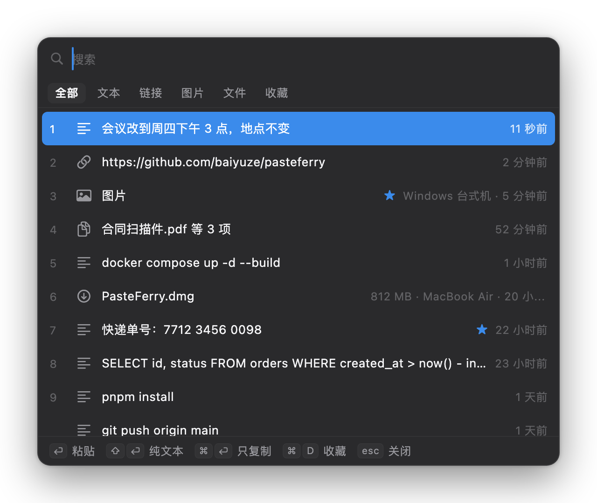
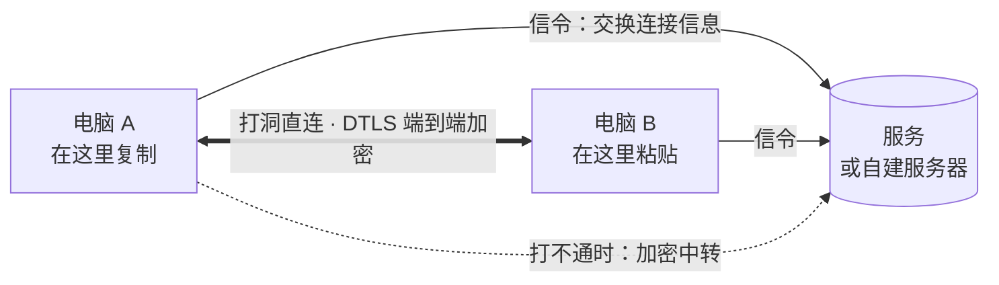
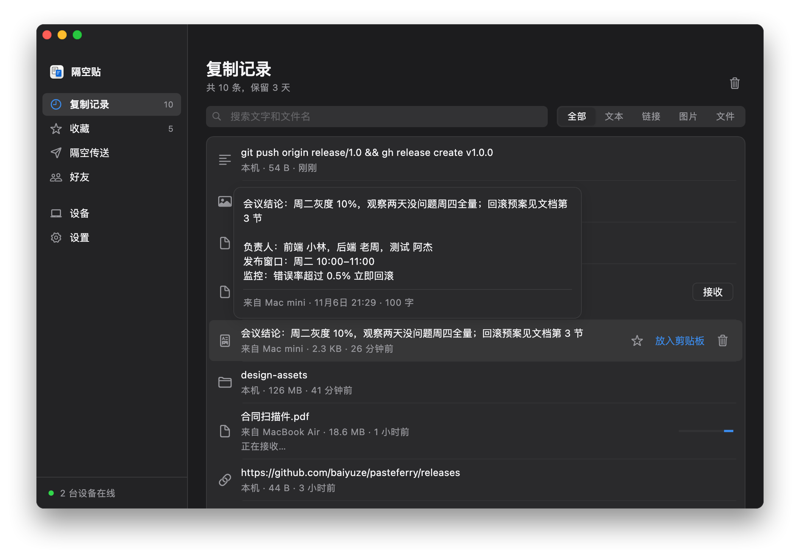
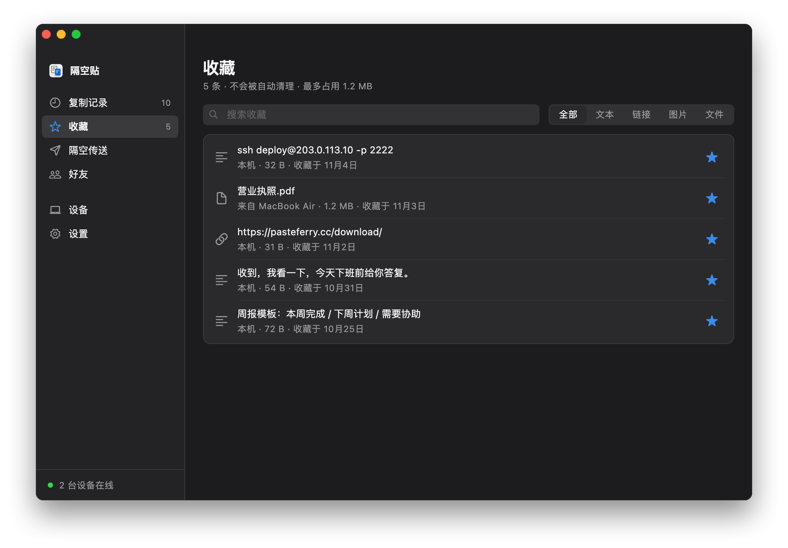

<p align="center">
  
</p>

<h1 align="center">隔空贴 PasteFerry</h1>

<p align="center">
  <strong>跨网直连，复制即达。</strong><br>
  局域网、跨网络均 P2P 直连，内容不经云端。端到端加密，打洞失败才走加密中转。剪贴板同步、复制历史与隔空传送，Mac、Windows、Linux 互通，无需同一账号；安卓和手机网页在局域网内互传照片和文件。
</p>

<p align="center">
  <a href="https://pasteferry.cc/download/"><strong>下载</strong></a>
  ·
  <a href="https://pasteferry.cc/">项目主页</a>
  ·
  <a href="https://pasteferry.cc/features/">功能演示</a>
  ·
  <a href="https://gitee.com/baiyuze/pasteferry/releases">国内镜像（Gitee）</a>
  ·
  <a href="README.md">English</a>
  ·
  <a href="README.tr.md">Türkçe</a>
</p>

<p align="center">
  
  
  
  
  
  
  
  
</p>

<p align="center">
  
</p>

<p align="center">如果隔空贴帮到了你，欢迎点一个 ⭐ Star，让更多人看到它。</p>

## 它解决什么问题

通用剪贴板要同一个 Apple ID、两台离得近；隔空投送每次都要点接收，也只能在近处用；发给自己要手动下载，文件还留在别人的服务器上。一台 Mac 一台 Windows，或者两台电脑不在同一个网络时，系统自带的办法一个都用不了。

隔空贴的做法：两台电脑配对一次，之后在一台上复制，另一台直接粘贴。局域网、跨网络均 P2P 直连，内容不经任何服务器。复制过的内容都在复制记录里，按 <kbd>⌥V</kbd>（Windows、Linux 上是 <kbd>Alt</kbd>+<kbd>V</kbd>）就能找出来贴进正在用的 App。

| | 隔空贴 | 通用剪贴板 | 隔空投送 | 聊天软件 |
|---|:-:|:-:|:-:|:-:|
| P2P 直连（局域网、跨网络） | ✓ | 只限近处 | 只限近处 | 经它们的服务器 |
| 不同 Apple ID 之间 | ✓ | — | 需对方接收 | ✓ |
| 复制后直接粘贴，不用点接收 | ✓ | ✓ | — | — |
| Mac 与 Windows 之间 | ✓ | — | — | ✓ |
| 文件与整个文件夹 | ✓ | 不稳定 | ✓ | 打包后可以 |
| 复制历史，随时找回 | ✓ | — | — | 翻聊天记录 |
| 仅自己的设备可解密内容 | ✓ | ✓ | ✓ | — |

## 核心：点对点直连，局域网与跨网络

设备之间 P2P 直连：局域网内直连，无需服务器；跨网络打洞直连。内容在设备之间直传，不经过任何服务器。



- **同一网络：不要服务器，跑满局域网**：靠 mDNS 互相发现，输入配对码就能直连。电脑之间的隔空传送走加密的 TCP 快速通道，实测 1 GB 文件从 Mac 传到 Linux 虚拟机 144 MB/s。安卓 App 和手机网页在局域网里同样直传。
- **跨网络打洞直连**：「服务」或自建服务器只负责信令（WebRTC，基于 [pion](https://github.com/pion/webrtc)）。
- **多线路网络直连**：双线接入这类网络按目标地址选出口。隔空贴在同一个 UDP 端口上同时询问多台 STUN 服务器，拿到每个出口的地址一并告诉对端；还会安排好哪一边先发包，避开会占住端口的路由器。实测 4 条线路的网络与家里宽带之间可以直连。
- **手机流量、随身 Wi‑Fi 直连（2.13）**：不少运营商的 NAT 给每个目标地址换一个新端口，但端口是按顺序发的。隔空贴认出这个规律，预测接下来的端口，连着手机热点或随身 Wi‑Fi 的电脑直接连上。只有端口完全随机分配的 NAT 仍需中转。
- **IPv6 直连（2.13）**：两台都有公网 IPv6 地址时直接走 IPv6，不用穿过任何 NAT。
- **路由器端口映射（2.14）**：路由器支持 UPnP、NAT-PMP 或 PCP 且有公网地址时，隔空贴在路由器上开一个端口，对方的包直接就能进来。
- **跨网络直连传得快（2.12）**：跨网络直连传文件一直偏慢时，自动多开几条并行连接，确实变快才保留。
- **打不通才中转**：中转转发的是端到端加密的数据包，服务器解不开；网络卡住 35 秒以内都能缓过来；空闲时会再试打洞，成功后切回直连。「设备」页会标出每台电脑是「直连」还是「中转」。
- **配对时核对安全指纹**：两块屏幕显示同样的两行指纹，之后的每条消息都带签名，服务器无法冒充你的设备。
- **每次提交都在实验室里验证**：[NAT 打洞实验室](tools/natlab) 用 Linux 网络命名空间和 iptables 模拟家用路由器、多出口网络、端口随机分配的 NAT 等 21 种场景，用隔空贴真实的连接代码各跑一遍。端口预测另在 pion 的虚拟网络上测试：按顺序分配端口的对称型 NAT 有预测能直连，没有就打不通。

跨网络直连目前是 Mac、Windows、Linux 电脑之间；安卓 App 和手机网页暂时在同一网络里用。

细节见[工作原理](https://pasteferry.cc/how/)与技术方案：[NAT 打洞](design/nat-traversal.md)（多出口网络、端口预测、IPv6）、[局域网直连](design/lan-mode.md)。

## 功能

### 在这台复制，到那台粘贴

- **文本、带格式的文本、图片、文件、整个文件夹**都能同步，复制什么，对面粘贴出来就是什么。
- **按大小分流**：50 MB 以内（可调）复制时就传好；更大的只同步一条记录，需要时点一下再取。
- **对方离线也不丢**：这期间复制的，连上后补进对方的复制记录。

### 隔空传送（2.8 起支持安卓）

- 打开「隔空传送」，配对过的电脑都在雷达上。把文件或整个文件夹拖到其中一台，就直接发过去。
- **不限大小**：能看到进度、速度和剩余时间；断了会从断点接着传，每个文件用 SHA-256 校验。
- 收到的文件默认存到「下载」（可以改），不进复制记录。电脑版要 2.5 或更新的版本，安卓要 2.8 或更新；安卓只在同一网络里传。

### 给好友发文件（2.6 新增）

- 别人的电脑不用配对：用一次性的好友码**加个好友**，之后把文件拖到对方的头像上就发过去，可以附一句备注。
- **收不收，对方说了算**：每批文件先弹出请求（谁发的、什么文件、备注），接受后才开始传；常来往的好友可以设成自动接收。
- **谁能发给你，你来定**：均不允许、仅限好友（默认），或者在局域网里对所有人开放 10 分钟。
- 好友之间只传文件和图片，看不到你的剪贴板、复制记录和其他设备。不在同一个网络时，两边都打开「服务」。两台都要是 2.6 或更新的版本。

### 从其他应用分享文件（2.12.2 新增）

系统菜单跟随系统语言，发送确认窗口跟随应用语言，支持现有全部 18 种语言。

选中文件，从系统入口选择隔空贴，核对文件并选择一台已配对的接收设备，确认后发送。走隔空传送，不加入剪贴板同步。

- **安卓 9 及以上**：在系统分享面板中选择隔空贴，支持文件、图片和视频，暂不含纯文字与链接；仍限局域网传输。
- **Mac**：Finder 中右键文件，选择「服务 → 通过隔空贴发送」。看不到时可在系统的服务设置中启用。
- **Windows**：使用经典右键菜单里的发送入口；Windows 11 先点「显示更多选项」。安装程序提供可选菜单项，便携版默认不注册。
- **Linux**：在「设置 → 隔空传送 → 安装菜单」添加 Nautilus「脚本」和 Dolphin 入口；tar 包的 `install.sh` 也会安装。手动卸载应用前，可先在设置中移除菜单。

### 快捷粘贴

- 在任何 App 里按 <kbd>⌥V</kbd>（Windows、Linux 上是 <kbd>Alt</kbd>+<kbd>V</kbd>），复制记录出现在屏幕中间。
- 打几个字搜索，**中文可以打拼音**：`huiyi` 或 `hy` 都能找到「会议」。
- 按 <kbd>1</kbd>–<kbd>9</kbd> 或回车，选中的内容直接粘贴到刚才的光标处；<kbd>⇧</kbd><kbd>↩</kbd> 粘贴纯文本，<kbd>⌘</kbd><kbd>↩</kbd> 只复制。快捷键可以在设置里更换或关闭。

### 复制记录与收藏

- **复制记录**：所有设备最近 3 天（可调）复制过的内容，可以按文本、链接、图片、文件筛选。鼠标停一下就能看到全文、大图或完整的文件列表。
- **收藏**：常用的内容点一下星标另存一份，不会过期，清空复制记录也还在。

<table>
  <tr>
    <td></td>
    <td></td>
  </tr>
</table>

### 主题（2.10 新增）

- **设置 › 外观**里分「软件自带」（默认、像素）与「自定义」两组，浅色、深色、跟随系统随你选。
- **像素主题**：缝合像素字体、切角方块、按钮斜面，配色是中性的「石墨」与「纸」加像素绿。页眉是夜景或白天，侧边栏底下有篝火或小房子，空页面有像素插画；隔空传送时纸飞机飞过去，完成时迸出星星。还可以打开 CRT 扫描线。
- **自定义主题**：复制一份自带主题，导入、导出 `.pasteferry-theme.json`，不要的删掉。保存时检查文字对比度，看不清会提醒。
- **让 AI 帮你做主题**：`pasteferry-cli mcp` 让 Claude、Cursor 等支持 MCP 的应用配色、校验并应用主题（见[下文](#让-ai-帮你做主题mcp)）。
- 主题只作用于这一台设备（电脑上包括主窗口和快捷粘贴窗口），不在设备之间同步；安卓 App 在自己的「设置 › 外观」里单独选。

<table>
  <tr>
    <td></td>
    <td></td>
  </tr>
</table>

### 其他

- 后台常驻，开机自启，崩溃自动恢复；App 里检查更新，确认后自动安装。
- 18 种界面语言：简体中文、繁体中文（台湾、香港）、英文、日文、韩文、阿拉伯文（从右到左）、德文、法文、西班牙文、葡萄牙文（巴西）、意大利文、俄文、乌克兰文、波兰文、土耳其文、越南文、印尼文。

## 开始使用

第一次用？跟着 **[快速开始](https://pasteferry.cc/start/)** 一步步来，有截图。

**1. 在每台电脑上安装 App**，到 **[下载页](https://pasteferry.cc/download/)** 选：

- **Mac**（macOS 13 以上）：[Apple 芯片版](https://github.com/baiyuze/pasteferry/releases/latest/download/PasteFerry-mac-apple-silicon.dmg)或 [Intel 版](https://github.com/baiyuze/pasteferry/releases/latest/download/PasteFerry-mac-intel.dmg)；也有两种芯片都能用的[通用版](https://github.com/baiyuze/pasteferry/releases/latest/download/PasteFerry.dmg)。
- **Windows** 10/11：[安装程序](https://github.com/baiyuze/pasteferry/releases/latest/download/PasteFerry-Setup.exe)或[便携版](https://github.com/baiyuze/pasteferry/releases/latest/download/PasteFerry-windows-x64.zip)。
- **安卓** 9 及以上，arm64：**[APK](https://github.com/baiyuze/pasteferry/releases/latest/download/PasteFerry-android-arm64.apk)**（测试版，安装时安卓会先询问）。可以在电脑上打开 **设备 → 手机网页传输** 用手机扫码，也可以装上 APK，像另一台电脑一样配对。
- **任何手机、平板，不用装 App**：在电脑上打开 **设备 → 手机网页传输**，用手机扫屏幕上的码。手机浏览器里的网页能看到电脑上的复制记录，把文字复制到手机，也能把文字、照片和文件发回电脑。需要在同一网络里，内容加密传输。
- **iPhone 与 iPad**：还没有 App，因为分发需要 Apple 开发者证书。请用上面的网页，在 Safari 里功能一样。
- **Linux**（X11，或带 XWayland 的 Wayland 桌面）：Ubuntu、Debian 用 `.deb`（[x64](https://github.com/baiyuze/pasteferry/releases/latest/download/PasteFerry-linux-amd64.deb)、[ARM64](https://github.com/baiyuze/pasteferry/releases/latest/download/PasteFerry-linux-arm64.deb)），其他发行版用 `tar.gz`（[x64](https://github.com/baiyuze/pasteferry/releases/latest/download/PasteFerry-linux-amd64.tar.gz)、[ARM64](https://github.com/baiyuze/pasteferry/releases/latest/download/PasteFerry-linux-arm64.tar.gz)），解压后运行 `./PasteFerry/install.sh` 加进应用菜单。

Mac 版还没有经过 Apple 公证，Windows 版还没有代码签名：Mac 上第一次打开时到 **系统设置 → 隐私与安全性** 点 **仍要打开**；Windows 上点 **更多信息 → 仍要运行**。然后点 **启用后台同步**。Windows 防火墙询问、macOS 询问能否查找本地网络上的设备时，都选择允许。想让快捷粘贴直接粘贴，Mac 上按 <kbd>⌥V</kbd> 后点底栏的 **去授权**，在「辅助功能」里打开隔空贴。

**2. 配对**：一台点 **设备 → 添加设备 → 生成配对码**，另一台点 **输入配对码**。两边显示的两行安全指纹完全一致后再确认。之后在任意一台上复制，另一台就能直接粘贴。

**3. 跨网络直连**：选一种方式让两台电脑找到彼此，都在同一网络里可以跳过这步。之后只要能打通，内容都在两台电脑之间直接传：

| 方式 | 适合 | 要准备 |
|---|---|---|
| **[服务](https://pasteferry.cc/official/)** | 跨网络，不想自建服务器 | 每台电脑在「设置 → 连接」里打开「使用服务」（默认关闭）。打不通直连时的中转当前默认每天 100 MB，直连不计 |
| **[同一网络](https://pasteferry.cc/lan/)** | 电脑都连着同一个路由器 | 什么都不用 |
| **[公网服务器](https://pasteferry.cc/cloud/)** | 想完全自己掌控 | 一台有公网 IP 的 Linux 云主机，最低配置就够 |
| **[Tailscale](https://pasteferry.cc/tailscale/)** | 跨网络，但没有服务器 | 每台电脑都装 [Tailscale](https://tailscale.com)，配对时输入对方的 Tailscale 地址 |

自建服务器只要一条安装命令，见[服务器部署说明](server/deploy/README.md)（Linux、macOS、Windows、Docker）。

| | 要求 |
|---|---|
| **Mac 客户端** | macOS 13 Ventura 及以上；Apple 芯片与 Intel 芯片 |
| **Windows 客户端** | Windows 10 与 11，x64 |
| **Linux 客户端** | x64 或 ARM64；X11 桌面，或带 XWayland 的 Wayland 桌面（GNOME、KDE 默认都带）；GTK 3 |
| **服务器** | 可选：Linux（x86_64、ARM64；systemd 或 Docker）、macOS，或 Windows 10/11 x64 |
| **安卓 App** | 9 及以上，arm64；测试版，安装时安卓会先询问 |
| **手机网页** | 同一网络里的任何手机或平板，不用安装 |
| **iPhone / iPad** | 没有 App：分发需要 Apple 开发者证书，iOS 也不允许 App 在后台监听剪贴板。请改用手机网页 |

### 通过 Homebrew 安装 Mac 版

官方 tap 安装的是完整桌面 App，并提供 App 内置的 `pasteferry-cli`：

```sh
brew tap baiyuze/tap
brew install --cask baiyuze/tap/pasteferry
```

已有手动安装的 App 时，先退出并移走 `/Applications/PasteFerry.app`，保留应用数据，再执行安装。
首次打开后启用后台同步并按提示授权。通过 Homebrew 升级：

```sh
brew update
brew upgrade --cask --greedy baiyuze/tap/pasteferry
```

`--greedy` 会包含支持 App 内更新的软件。卸载使用 `brew uninstall --cask baiyuze/tap/pasteferry`，保留配对、历史和设置。
详见 [官方 tap](https://github.com/baiyuze/homebrew-tap)。

### 命令行查询（2.9 起）

桌面 App 自带 CLI；Homebrew 会把它加入命令路径。手动安装的 Mac App 可以从
`/Applications/PasteFerry.app/Contents/Helpers/pasteferry-cli` 调用；Windows 使用安装目录中的
`pasteferry-cli.exe`，Linux 使用 `pasteferry-cli`。

```sh
pasteferry-cli version
pasteferry-cli -json status
pasteferry-cli -json devices
pasteferry-cli -json history
pasteferry-cli -json config get
```

`version` 无需后台服务；其他查询读取当前登录用户正在使用的后台服务。
`-json` 放在命令前，输出统一的 `ok`/`data` 或 `ok`/`error` JSON；历史返回最近 20 条摘要。
不加 `-json` 时沿用文本输出。可用 `-data-dir DIR` 指定一个已经运行的实例的数据目录；CLI 本身不启动后台服务。
JSON 模式支持上述只读查询，格式及示例见 [CLI JSON 接口](design/cli-json.md)。

### 让 AI 帮你做主题（MCP）

`pasteferry-cli mcp` 是一个 MCP 服务（2.10 起）。把它加到 AI 应用里，然后直接说「帮我做一套赛博朋克风的主题」：AI 会读取主题格式、配色、检查对比度，保存后应用。它只能读写主题和背景图，看不到复制记录、设备和好友。「设置 › 外观 › 让 AI 帮你做主题」里有填好本机路径的配置，可以直接复制。

Claude Desktop 与 Cursor（`~/.cursor/mcp.json`）：

```json
{
  "mcpServers": {
    "pasteferry": {
      "command": "/Applications/PasteFerry.app/Contents/Helpers/pasteferry-cli",
      "args": ["mcp"]
    }
  }
}
```

Claude Code：

```sh
claude mcp add pasteferry -- /Applications/PasteFerry.app/Contents/Helpers/pasteferry-cli mcp
```

Windows 上命令是 `%LOCALAPPDATA%\Programs\PasteFerry\pasteferry-cli.exe`，Linux 的 `.deb` 包是 `/usr/bin/pasteferry-cli`。后台服务要在运行。工具清单与更多例子见[让 AI 帮你做主题](guide/ai-themes.zh-CN.md)。

## 文档

- [工作原理](guide/how-it-works.zh-CN.md)：架构、NAT 打洞、安全模型、兜底、踩过的坑
- [排障](guide/troubleshooting.zh-CN.md)与已知限制
- [让 AI 帮你做主题](guide/ai-themes.zh-CN.md)（MCP）
- 图文教程：[快速开始](https://pasteferry.cc/start/) · [服务](https://pasteferry.cc/official/) · [同一网络](https://pasteferry.cc/lan/) · [公网服务器](https://pasteferry.cc/cloud/) · [Tailscale](https://pasteferry.cc/tailscale/)
- [服务器部署说明](server/deploy/README.md)、[从源码构建](guide/building.zh-CN.md)
- 技术方案：[多出口网络的 NAT 打洞](design/nat-traversal.md)、[局域网直连](design/lan-mode.md)、[快捷粘贴与收藏](design/quick-paste-and-favorites.md)、[隔空传送](design/send-files.md)、[Windows 客户端](design/windows-client.md)、[主题](design/themes.md)、[像素主题](design/pixel-theme.md)、[MCP](design/mcp.md)
- [隐私说明](PRIVACY.md)、[安全说明](SECURITY.md)、[「服务」的公开协议](design/official-gateway.md)
- [更新记录](CHANGELOG.md)

## 参与贡献

提交 PR 前请阅读[贡献规范](CONTRIBUTING.zh-CN.md)。每个 PR 只处理一个独立目标，相关测试和文档可以一并提交。
较大改动请先开 Issue 讨论，并在 PR 模板中写清修改范围和实际验证结果。

## 支持一下

隔空贴免费开源。如果它帮到了你，**点一个 ⭐ Star** 就是最好的支持，也能让更多需要它的人看到。遇到问题或有想法，欢迎[提 issue](https://github.com/baiyuze/pasteferry/issues)。

## 许可

隔空贴以 [GNU AGPL-3.0](LICENSE) 免费开源：任何人（包括公司）都可以使用和修改，但分发它、或通过网络提供修改过的版本时，必须以同样的许可公开你的源码。详见 [LICENSING.md](LICENSING.md)。1.2.0 及更早的版本仍适用 MIT 许可。
