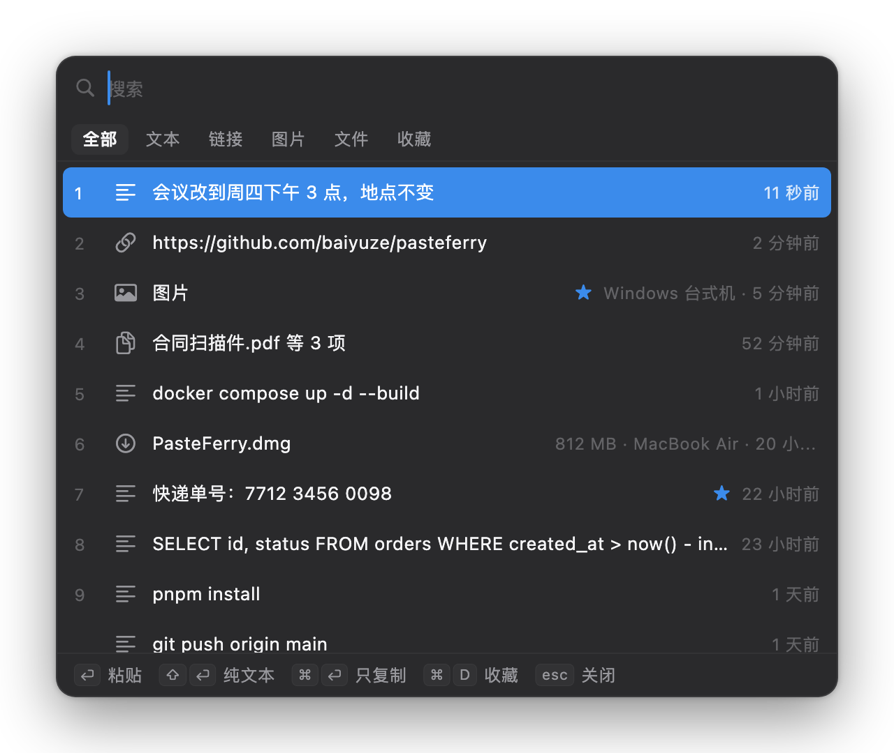
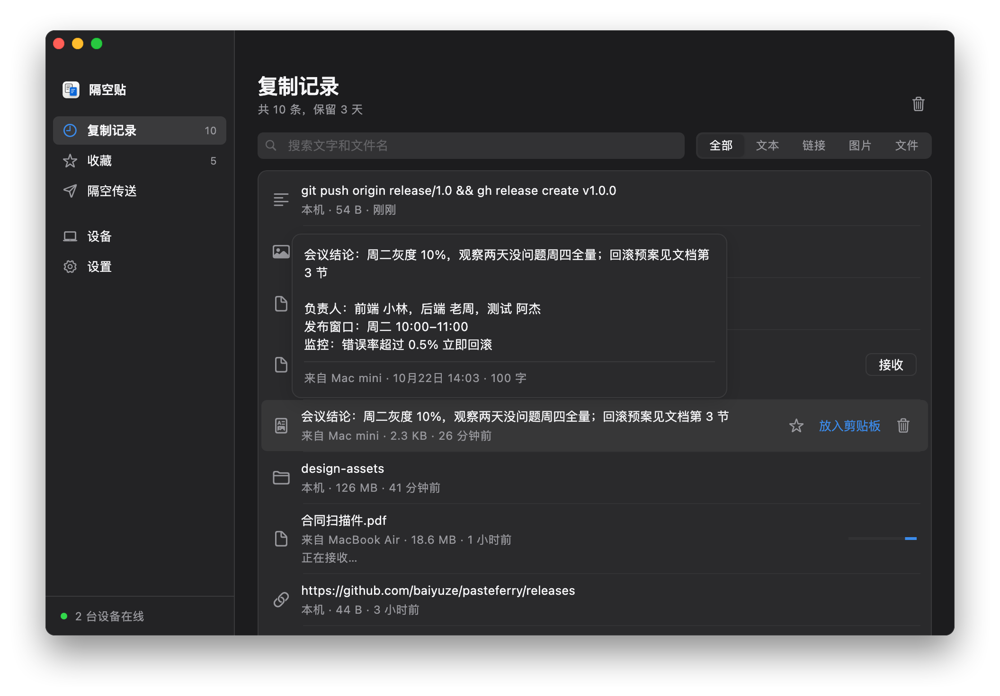
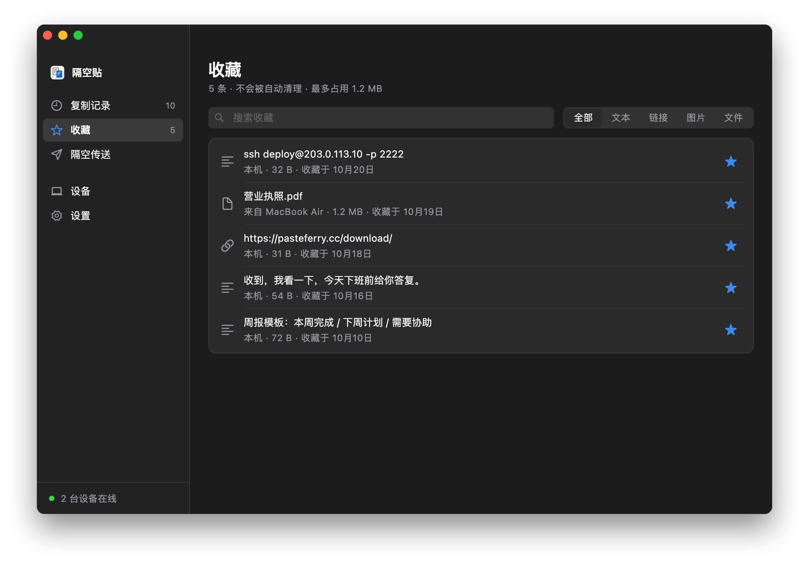
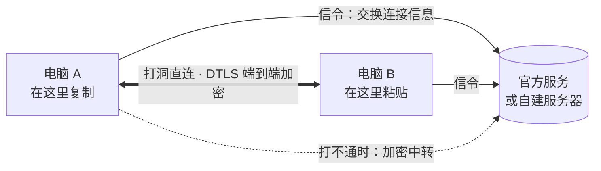

  

<h1 align="center">隔空贴 PasteFerry</h1>

  在这台电脑复制，到那台电脑粘贴；按一下 <kbd>⌥V</kbd>，复制过的随叫随到。 
  Mac、Windows、Linux 互通，不限账号；不在同一个网络，也能打洞直连。

  <a href="https://pasteferry.cc/download/"><strong>下载</strong></a>
  ·
  <a href="https://pasteferry.cc/">项目主页</a>
  ·
  <a href="https://pasteferry.cc/features/">功能演示</a>
  ·
  <a href="https://gitee.com/baiyuze/pasteferry/releases">国内镜像（Gitee）</a>
  ·
  <a href="README.md">English</a>

  
  
  
  
  

  

如果隔空贴帮到了你，欢迎点一个 ⭐ Star，让更多人看到它。

## 它解决什么问题

通用剪贴板要同一个 Apple ID、两台离得近；隔空投送每次都要点接收；发给自己要手动下载，文件还留在别人的服务器上。一台 Mac 一台 Windows 时，系统自带的办法一个都用不了。

隔空贴的做法：两台电脑配对一次，之后在一台上复制，另一台直接粘贴。复制过的内容都在复制记录里，按 <kbd>⌥V</kbd>（Windows、Linux 上是 <kbd>Alt</kbd>+<kbd>V</kbd>）就能找出来贴进正在用的 App。

| | 隔空贴 | 通用剪贴板 | 隔空投送 | 聊天软件 |
|---|:-:|:-:|:-:|:-:|
| 不同 Apple ID 之间 | ✓ | — | 需对方接收 | ✓ |
| 不在同一个网络（家里 ↔ 公司） | ✓ | — | — | ✓ |
| 复制后直接粘贴，不用点接收 | ✓ | ✓ | — | — |
| Mac 与 Windows 之间 | ✓ | — | — | ✓ |
| 文件与整个文件夹 | ✓ | 不稳定 | ✓ | 打包后可以 |
| 复制历史，随时找回 | ✓ | — | — | 翻聊天记录 |
| 仅自己的设备可解密内容 | ✓ | ✓ | ✓ | — |

## 功能

### 在这台复制，到那台粘贴

- **文本、带格式的文本、图片、文件、整个文件夹**都能同步，复制什么，对面粘贴出来就是什么。
- **按大小分流**：50 MB 以内（可调）复制时就传好；更大的只同步一条记录，需要时点一下再取。
- **对方离线也不丢**：这期间复制的，连上后补进对方的复制记录。

### 隔空传送（2.5 新增）

- 打开「隔空传送」，配对过的电脑都在雷达上。把文件或整个文件夹拖到其中一台，就直接发过去。
- **不限大小**：能看到进度、速度和剩余时间；断了会从断点接着传，每个文件用 SHA-256 校验。
- 收到的文件默认存到「下载」（可以改），不进复制记录。两台都要是 2.5 或更新的版本。

### 快捷粘贴

- 在任何 App 里按 <kbd>⌥V</kbd>（Windows、Linux 上是 <kbd>Alt</kbd>+<kbd>V</kbd>），复制记录出现在屏幕中间。
- 打几个字搜索，**中文可以打拼音**：`huiyi` 或 `hy` 都能找到「会议」。
- 按 <kbd>1</kbd>–<kbd>9</kbd> 或回车，选中的内容直接粘贴到刚才的光标处；<kbd>⇧</kbd><kbd>↩</kbd> 粘贴纯文本，<kbd>⌘</kbd><kbd>↩</kbd> 只复制。快捷键可以在设置里更换或关闭。

### 复制记录与收藏

- **复制记录**：所有设备最近 3 天（可调）复制过的内容，可以按文本、链接、图片、文件筛选。鼠标停一下就能看到全文、大图或完整的文件列表。
- **收藏**：常用的内容点一下星标另存一份，不会过期，清空复制记录也还在。

<table>
  <tr>
    <td></td>
    <td></td>
  </tr>
</table>

### 其他

- 后台常驻，开机自启，崩溃自动恢复；App 里检查更新，确认后自动安装。
- 简体中文、繁体中文（台湾、香港）、英文、日文界面。

## 核心：打洞直连

隔空贴的一切都建立在「两台电脑直接连起来」上：内容在两台电脑之间直接传，不经过谁的服务器。

- **同一网络里不需要服务器**：靠 mDNS 互相发现，输入配对码就能直连。
- **跨网络时服务器只牵线**：官方服务或自建服务器帮两台电脑交换连接信息，然后它们打洞直连（WebRTC，基于 [pion](https://github.com/pion/webrtc)）。
- **多出口网络也能直连**：公司双线这类网络按目标地址选出口。隔空贴在同一个 UDP 端口上同时询问多台 STUN 服务器，拿到每个出口的地址一并告诉对端；还会安排好哪一边先发包，避开会占住端口的路由器。实测公司 4 个出口与家里宽带之间可以直连。
- **打不通才中转**：中转转发的是端到端加密的数据包，服务器解不开；空闲时会再试打洞，成功后切回直连。
- **配对时核对安全指纹**：两块屏幕显示同样的两行指纹，之后的每条消息都带签名，服务器无法冒充你的设备。
- **每次提交都在实验室里验证**：[NAT 打洞实验室](tools/natlab) 用 Linux 网络命名空间和 iptables 模拟家用路由器、多出口网络、端口随机分配的 NAT 等 16 种场景，用隔空贴真实的连接代码各跑一遍。

细节见[工作原理](https://pasteferry.cc/how/)与技术方案：[多出口网络的 NAT 打洞](design/nat-traversal.md)、[局域网直连](design/lan-mode.md)。

## 开始使用

第一次用？跟着 **[快速开始](https://pasteferry.cc/start/)** 一步步来，有截图。

**1. 在每台电脑上安装 App**，到 **[下载页](https://pasteferry.cc/download/)** 选：

- **Mac**（macOS 13 以上）：[Apple 芯片版](https://github.com/baiyuze/pasteferry/releases/latest/download/PasteFerry-mac-apple-silicon.dmg)或 [Intel 版](https://github.com/baiyuze/pasteferry/releases/latest/download/PasteFerry-mac-intel.dmg)；也有两种芯片都能用的[通用版](https://github.com/baiyuze/pasteferry/releases/latest/download/PasteFerry.dmg)。
- **Windows** 10/11：[安装程序](https://github.com/baiyuze/pasteferry/releases/latest/download/PasteFerry-Setup.exe)或[便携版](https://github.com/baiyuze/pasteferry/releases/latest/download/PasteFerry-windows-x64.zip)。
- **Linux**（X11，或带 XWayland 的 Wayland 桌面）：Ubuntu、Debian 用 `.deb`（[x64](https://github.com/baiyuze/pasteferry/releases/latest/download/PasteFerry-linux-amd64.deb)、[ARM64](https://github.com/baiyuze/pasteferry/releases/latest/download/PasteFerry-linux-arm64.deb)），其他发行版用 `tar.gz`（[x64](https://github.com/baiyuze/pasteferry/releases/latest/download/PasteFerry-linux-amd64.tar.gz)、[ARM64](https://github.com/baiyuze/pasteferry/releases/latest/download/PasteFerry-linux-arm64.tar.gz)），解压后运行 `./PasteFerry/install.sh` 加进应用菜单。

Mac 版还没有经过 Apple 公证，Windows 版还没有代码签名：Mac 上第一次打开时到 **系统设置 → 隐私与安全性** 点 **仍要打开**；Windows 上点 **更多信息 → 仍要运行**。然后点 **启用后台同步**。Windows 防火墙询问、macOS 询问能否查找本地网络上的设备时，都选择允许。想让快捷粘贴直接粘贴，Mac 上按 <kbd>⌥V</kbd> 后点底栏的 **去授权**，在「辅助功能」里打开隔空贴。

**2. 配对。**一台点 **设备 → 添加设备 → 生成配对码**，另一台点 **输入配对码**。两边显示的两行安全指纹完全一致后再确认。之后在任意一台上复制，另一台就能直接粘贴。

**3. 跨网络时（可选）**，选一种连接方式：

| 方式 | 适合 | 要准备 |
|---|---|---|
| **[官方服务](https://pasteferry.cc/official/)** | 跨网络，不想自建服务器 | 每台电脑在「设置」里打开「使用官方服务」（默认关闭）。打不通直连时的中转当前默认每天 100 MB，直连不计 |
| **[同一网络](https://pasteferry.cc/lan/)** | 电脑都连着同一个路由器 | 什么都不用 |
| **[公网服务器](https://pasteferry.cc/cloud/)** | 想完全自己掌控 | 一台有公网 IP 的 Linux 云主机，最低配置就够 |
| **[Tailscale](https://pasteferry.cc/tailscale/)** | 跨网络，但没有服务器 | 每台电脑都装 [Tailscale](https://tailscale.com)，配对时输入对方的 Tailscale 地址 |

自建服务器只要一条安装命令，见[服务器部署说明](server/deploy/README.md)（Linux、macOS、Windows、Docker）。

| | 要求 |
|---|---|
| **Mac 客户端** | macOS 13 Ventura 及以上；Apple 芯片与 Intel 芯片 |
| **Windows 客户端** | Windows 10 与 11，x64 |
| **Linux 客户端** | x64 或 ARM64；X11 桌面，或带 XWayland 的 Wayland 桌面（GNOME、KDE 默认都带）；GTK 3 |
| **服务器** | 可选：Linux（x86_64、ARM64；systemd 或 Docker）、macOS，或 Windows 10/11 x64 |
| **iPhone / iPad** | 暂不支持：iOS 不允许 App 在后台监听剪贴板 |

## 文档

- [工作原理](guide/how-it-works.zh-CN.md)：架构、NAT 打洞、安全模型、兜底、踩过的坑
- [排障](guide/troubleshooting.zh-CN.md)与已知限制
- 图文教程：[快速开始](https://pasteferry.cc/start/) · [官方服务](https://pasteferry.cc/official/) · [同一网络](https://pasteferry.cc/lan/) · [公网服务器](https://pasteferry.cc/cloud/) · [Tailscale](https://pasteferry.cc/tailscale/)
- [服务器部署说明](server/deploy/README.md)、[从源码构建](guide/building.zh-CN.md)
- 技术方案：[多出口网络的 NAT 打洞](design/nat-traversal.md)、[局域网直连](design/lan-mode.md)、[快捷粘贴与收藏](design/quick-paste-and-favorites.md)、[隔空传送](design/send-files.md)、[Windows 客户端](design/windows-client.md)
- [隐私说明](PRIVACY.md)、[安全说明](SECURITY.md)、[官方服务的公开协议](design/official-gateway.md)
- [更新记录](CHANGELOG.md)

## 支持一下

隔空贴免费开源。如果它帮到了你，**点一个 ⭐ Star** 就是最好的支持，也能让更多需要它的人看到。遇到问题或有想法，欢迎[提 issue](https://github.com/baiyuze/pasteferry/issues)。

## 许可

隔空贴以 [GNU AGPL-3.0](LICENSE) 免费开源：任何人（包括公司）都可以使用和修改，但分发它、或通过网络提供修改过的版本时，必须以同样的许可公开你的源码。详见 [LICENSING.md](LICENSING.md)。1.2.0 及更早的版本仍适用 MIT 许可。
